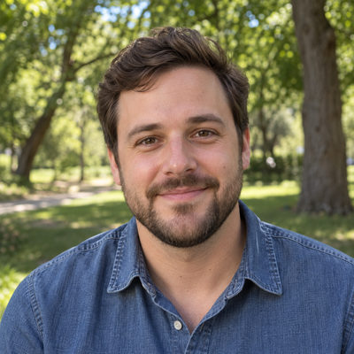
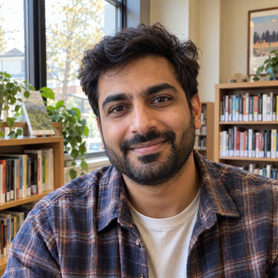
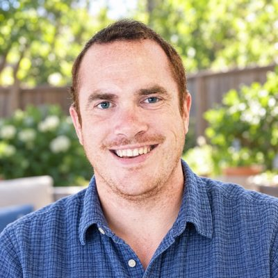
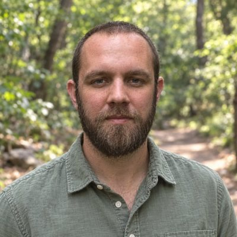
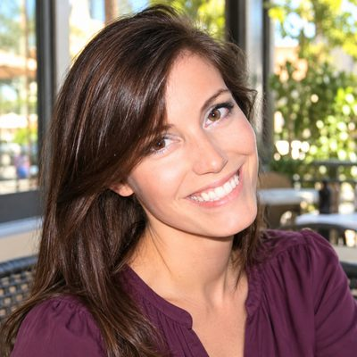
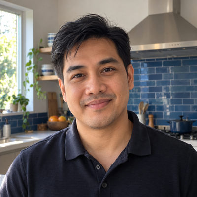
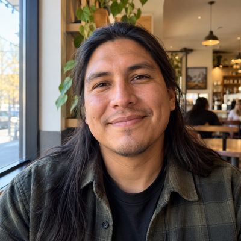
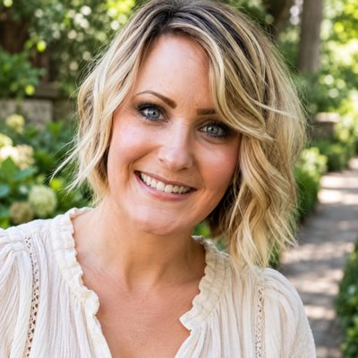

# Meet the Cast

The Cast is 83 hand-designed households and 181 people. They are the same in every dataset and always live on the Phoenix campus, so tests and documentation can rely on them by Guid.

Each family has its own page with photos, backstories, and what it is used to test. **Featured** families are the ones most used in testing; they have a short bio for each person.

Every photo is AI-generated to look like a casual profile picture. Legacy families have new photos based on their old ones, so the faces Rock users know stay recognizable (see [Photos](../../photos/README.md)).

## Featured families

| | Family | Who | Used to test |
|---|---|---|---|
|  | [Alvarez Family](alvarez.md) | Marco, Elena, Sofia, Mateo | Newborn in the nursery and a preschooler, so two check-in areas for one family. |
|  | [Brooks Family](brooks.md) | Nathan, Rachel, Ava, Caleb, Lily | Three kids across the student and elementary check-in areas. |
|  | [Carter Family](carter.md) | Peggy | Widow living alone, age 78. |
|  | [Coffee](coffee.md) | Phil | Invited-by-a-friend journey from first visit to baptism. |
|  | [Decker Family](decker.md) | Ted, Cindy, Noah, Alex | Primary demo family used in documentation and screenshots. |
|  | [Dexter Family](dexter.md) | Frank | Failed background check that needs review. |
|  | [Foster Family](foster.md) | Pete, Pamela | Senior pastor with pastoral and staff security roles. |
|  | [Garcia Family](garcia.md) | Daniel, Maria, Olivia, Bella, Leo | Twins with the same birthday. |
|  | [Gilbert](gilbert.md) | Brian, Wendy | Couple with matching connection requests to serve together. |
| (no photo, on purpose) | [Greggs](greggs-jenny.md) | Jenny | Deceased child record kept in its own family. |
|  | [Greggs](greggs.md) | Bob, Lorraine, Tim, Jordan | Grieving family with sensitive alert notes. |
|  | [Hanks Family](hanks.md) | Sam | Engaged non-staff adult who could be recruited to serve. |
|  | [Jackson Family](jackson.md) | Mariah, Maddie | Single parent whose child has a different last name. |
|  | [Jones Family](jones-ben.md) | Ben, Brian | Divorced parent with joint custody; the child belongs to two families. |
|  | [Kelly Family](kelly.md) | Ashley, Mason, Chloe | Benevolence request (Phase 1). |
|  | [Lowe Family](lowe.md) | Craig, Trish | Visitor household that gives regularly. |
|  | [Marble Family](marble.md) | Alisha, Bill | Rock administrator with many security roles. |
|  | [Michaels Family](michaels.md) | Jenny | Volunteer with the Staff-Like Users role. |
| (no photo, on purpose) | [Miller Family](miller-thomas.md) | Thomas | Duplicate half of a merge-testing pair (same email and phone, different address). |
|  | [Miller Family](miller-tom.md) | Tom | Original half of a duplicate pair for merge testing. |
|  | [Peak Family](peak.md) | Daniel | Staff member with website and communication administrator roles. |
|  | [Peterson Family](peterson.md) | Brian, Becky | Married couple where one spouse has no email. |
|  | [Ramirez Family](ramirez.md) | Carlos, Ana, Lucas, Mia | First-time guests: first visit two weeks ago. |
|  | [Richards](richards.md) | Dan | Single Prospect who is already in a small group. |
|  | [Simmons Family](simmons.md) | Jim, Sarah | Blended family with a child shared with another household. |
|  | [Smith Family](smith-john-other.md) | John | Duplicate detection: common name that must NOT be merged. |
|  | [Smith Family](smith-jon.md) | Jon | Duplicate detection: original record of a three-way duplicate. |
|  | [Song](song.md) | Allie | The inviting friend in an invitation story. |
|  | [Webb](webb.md) | Marty, Deb | Married couple who are still Prospects but already in a small group. |

## All families

| Family | Origin | People | Statuses | Used to test |
|---|---|---|---|---|
| [Alvarez Family](alvarez.md) | new | 4 | Connected | Newborn in the nursery and a preschooler, so two check-in areas for one family. |
| [Bell Family](bell.md) | new | 2 | Engaged | Greeters (guest services in Phase 1). |
| [Bennett Family](bennett.md) | new | 3 | Connected | Middle school student whose attendance drops in spring. |
| [Brooks Family](brooks.md) | new | 5 | Engaged | Three kids across the student and elementary check-in areas. |
| [Carter Family](carter.md) | new | 1 | Engaged | Widow living alone, age 78. |
| [Cholla Creek Hardware](cholla-creek-hardware.md) | legacy | 1 | Prospect | Business record. |
| [Coffee](coffee.md) | legacy | 1 | Engaged | Invited-by-a-friend journey from first visit to baptism. |
| [Coleman Family](coleman.md) | new | 4 | Connected | Two working parents, two check-in rooms. |
| [Cruz Family](cruz.md) | new | 4 | Participant | Participants through an event registration (VBS). |
| [Dawson Family](dawson.md) | new | 3 | Connected | Single dad with every-other-weekend attendance. |
| [Decker Family](decker.md) | legacy | 4 | Leading, Engaged, Connected | Primary demo family used in documentation and screenshots. |
| [Dexter Family](dexter.md) | legacy | 1 | Engaged | Failed background check that needs review. |
| [Diaz Family](diaz.md) | new | 2 | Known | Holiday-only attenders. |
| [Ellis Family](ellis.md) | new | 2 | Known | New couple: first visit about four months ago. |
| [Evans](evans.md) | legacy | 1 | Prospect | Event guest who needs follow-up. |
| [Fischer Family](fischer.md) | new | 4 | Connected | High school students, including a senior about to graduate. |
| [Flores Family](flores.md) | new | 3 | Connected | Never-married single parent. |
| [Foster Family](foster.md) | legacy | 2 | Leading, Engaged | Senior pastor with pastoral and staff security roles. |
| [Garcia Family](garcia.md) | new | 5 | Engaged | Twins with the same birthday. |
| [Gilbert](gilbert.md) | legacy | 2 | Prospect | Couple with matching connection requests to serve together. |
| [Gray Family](gray.md) | new | 1 | Connected | Attends many different services (low primary-service share). |
| [Greggs](greggs-jenny.md) | legacy | 1 | Known | Deceased child record kept in its own family. |
| [Greggs](greggs.md) | legacy | 4 | Leading, Engaged | Grieving family with sensitive alert notes. |
| [Hall Family](hall.md) | new | 1 | Participant | Participant: one in-person touch (a serve day), no Sunday attendance. |
| [Hanks Family](hanks.md) | legacy | 1 | Engaged | Engaged non-staff adult who could be recruited to serve. |
| [Hansen](hansen.md) | legacy | 1 | Prospect | Open connection request that needs a connector. |
| [Harper Family](harper.md) | legacy | 1 | Connected | Pending record that needs review. |
| [Hayes Family](hayes.md) | new | 2 | Engaged | Senior couple with a long anniversary. |
| [Hernandez Family](hernandez.md) | new | 1 | Engaged | Young single volunteer (worship team in Phase 1). |
| [Hughes Family](hughes.md) | new | 5 | Engaged | Three kids in three check-in rooms, from nursery to kindergarten. |
| [Jackson Family](jackson.md) | legacy | 2 | Engaged | Single parent whose child has a different last name. |
| [Jenkins Family](jenkins.md) | new | 3 | Engaged | Grandparents raising a grandchild. |
| [Jones Family](jones-ben.md) | legacy | 2 | Known, Connected | Divorced parent with joint custody; the child belongs to two families. |
| [Jones Family](jones-will.md) | legacy | 1 | Connected | Pending record that needs review. |
| [Kelly Family](kelly.md) | new | 3 | Known | Benevolence request (Phase 1). |
| [Kim Family](kim.md) | new | 3 | Connected | Adult child living at home (adult role in the family). |
| [Lee Family](lee.md) | new | 8 | Leading, Engaged | Family of eight with kids in every check-in area. |
| [Lowe Family](lowe.md) | legacy | 2 | Known | Visitor household that gives regularly. |
| [Marble Family](marble.md) | legacy | 2 | Leading | Rock administrator with many security roles. |
| [McClintock Family](mcclintock.md) | legacy | 1 | Connected | Young adult living alone. |
| [Michaels Family](michaels.md) | legacy | 1 | Engaged | Volunteer with the Staff-Like Users role. |
| [Miller Family](miller-thomas.md) | legacy | 1 | Prospect | Duplicate half of a merge-testing pair (same email and phone, different address). |
| [Miller Family](miller-tom.md) | legacy | 1 | Engaged | Original half of a duplicate pair for merge testing. |
| [Morgan Family](morgan.md) | new | 2 | Engaged | Quarterly giver with a year-end gift. |
| [Murphy Family](murphy.md) | new | 3 | Engaged | Inactive record with the Moved reason. |
| [Nguyen Family](nguyen.md) | new | 1 | Engaged | Single adult who gives weekly online by card. |
| [Ortiz Family](ortiz.md) | new | 3 | Connected | Lapsed family: attendance and giving stopped about six months ago. |
| [Patel Family](patel.md) | new | 2 | Engaged | Gives every week but seldom attends in person. |
| [Peak Family](peak.md) | legacy | 1 | Engaged | Staff member with website and communication administrator roles. |
| [Perry Family](perry.md) | new | 1 | Known | Married man attending without his spouse (spouse not in the database). |
| [Peterson Family](peterson.md) | legacy | 2 | Connected | Married couple where one spouse has no email. |
| [Price Family](price.md) | new | 2 | Engaged | Top 1% giver with large quarterly gifts. |
| [Ramirez Family](ramirez.md) | new | 4 | Prospect | First-time guests: first visit two weeks ago. |
| [Ramos Family](ramos.md) | new | 1 | Known | Group-first connection (Phase 1). |
| [Richards](richards.md) | legacy | 1 | Prospect | Single Prospect who is already in a small group. |
| [Rivera Family](rivera.md) | new | 3 | Leading, Engaged | Adopted child whose photo ethnicity is set on her own record. |
| [Ross Family](ross.md) | new | 2 | Connected | Seasonal attenders (winter visitors). |
| [Russell Family](russell.md) | new | 1 | Engaged | Homebound senior and widower. |
| [Saguaro Ridge Glass and Screen](saguaro-ridge-glass.md) | legacy | 1 | Prospect | Business record linked to its owner. |
| [Sanders Family](sanders.md) | new | 1 | Connected | New believer baptized recently (steps in Phase 1). |
| [Shaw Family](shaw.md) | new | 4 | Connected | Transfer family from another church. |
| [Silva Family](silva.md) | new | 2 | Leading, Engaged | Every gift goes to two funds. |
| [Simmons Family](simmons.md) | legacy | 2 | Engaged | Blended family with a child shared with another household. |
| [Smith Family](smith-john-duplicate-a.md) | legacy | 1 | Prospect | Duplicate detection: same email and address, phone stored as a different type. |
| [Smith Family](smith-john-duplicate-b.md) | legacy | 1 | Connected | Duplicate detection: same email and address, phone stored as a different type. |
| [Smith Family](smith-john-other.md) | legacy | 1 | Prospect | Duplicate detection: common name that must NOT be merged. |
| [Smith Family](smith-jon.md) | legacy | 1 | Engaged | Duplicate detection: original record of a three-way duplicate. |
| [Smith Family](smith-paul.md) | legacy | 1 | Connected | Young adult living alone. |
| [Song](song.md) | legacy | 1 | Engaged | The inviting friend in an invitation story. |
| [Stone](stone.md) | legacy | 1 | Connected | Middle initial and a nickname that differs from the first name. |
| [Sullivan Family](sullivan.md) | new | 5 | Engaged | Blended family with half siblings. |
| [Sweeney Family](sweeney.md) | legacy | 2 | Connected | Married couple in the same small group. |
| [Tennant Family](tennant.md) | legacy | 2 | Connected | Married couple with different employers. |
| [Torres Family](torres.md) | new | 3 | Participant, Connected | Teen who is more engaged than her parents. |
| [Tucker Family](tucker.md) | legacy | 1 | Connected | Pending record that needs review. |
| [Turner](turner.md) | legacy | 1 | Prospect | Open connection request that needs a connector. |
| [Ward Family](ward.md) | new | 4 | Connected | One-time giver. |
| [Washington Family](washington.md) | new | 3 | Engaged | An 18-year-old who is still a child in the family. |
| [Watson Family](watson.md) | new | 2 | Known | Year-end-only giver. |
| [Webb](webb.md) | legacy | 2 | Prospect | Married couple who are still Prospects but already in a small group. |
| [Wood Family](wood.md) | new | 4 | Connected | Middle school student in the student check-in area. |
| [Wright Family](wright.md) | new | 2 | Leading, Engaged | Weekly cash giver. |
| [Young Family](young.md) | new | 2 | Participant | Participant through a community event. |

---

Generated by `cast/build-pages.js`. Edit the household files, then rerun the script.
