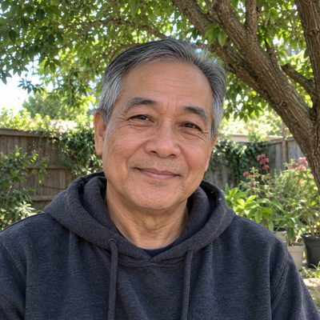
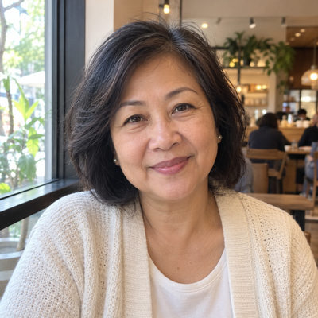

# Bell Family

New household · 2 people · Phoenix campus · [source](../households/bell.json)

Larry and Debra Bell greet at the front doors every Sunday. Their gift goes out by ACH on the first of the month.

| Photo | Name | Age | Role | Status |
|---|---|---|---|---|
|  | Larry (Lawrence) Bell | 66 | adult | Engaged |
|  | Deb (Debra) Bell | 64 | adult | Engaged |

## People

### Larry (Lawrence) Bell

- Age 66 · married · email larry.bell@example.org · groups: Greeters, Silva Group, Wright Group (left), Hughes Group (group ended) · business contact for Cholla Creek Hardware
- Person Guid `65B88091-00EE-4E28-9136-42B45E0C7188`

### Deb (Debra) Bell

- Age 64 · married · email deb.bell@example.org · groups: Greeters, Silva Group, Wright Group (left), Hughes Group (group ended)
- Person Guid `727A0988-9147-40E0-96D5-12D90F3C2DDD`

## What this family tests

- Greeters on the Phoenix Greeters team.
- Monthly scheduled ACH giver.

## Activity

- **Attendance:** core, 86% of Sundays, since 14 years ago.
- **Giving:** **monthly** by Larry Bell: $220 General Fund per gift, gives in 100% of periods, started 12 years ago.
- **Giving units:** the couple gives together as one giving unit.

## Address

3482 E Paradise Ln, Phoenix, AZ 85032 (a real street with a house number that does not exist)

---

Generated by `cast/build-pages.js` from the household file. Edit the JSON, then rerun the script.
