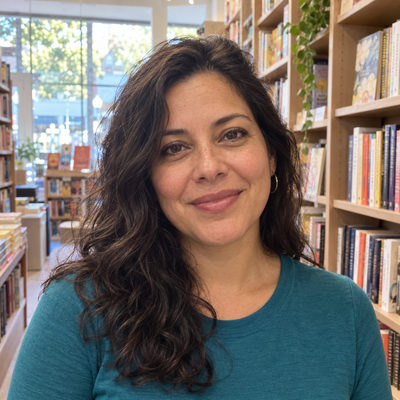

# Bennett Family

New household · 3 people · Phoenix campus · [source](../households/bennett.json)

Tom and Rebecca Bennett both teach. Their son Nick is in eighth grade and plays travel soccer on Sunday mornings in the spring.

| Photo | Name | Age | Role | Status |
|---|---|---|---|---|
|  | Tom (Thomas) Bennett | 44 | adult | Connected |
|  | Becca (Rebecca) Bennett | 42 | adult | Connected |
|  | Nick (Nicholas) Bennett | 13 | child | Connected |

## People

### Tom (Thomas) Bennett

- Age 44 · married · Palo Verde Technical College · email tom.bennett@example.org · groups: Silva Group (host), Lee Group (left)
- Person Guid `79557805-4355-43FB-B5D9-D563685F13DE`

### Becca (Rebecca) Bennett

- Age 42 · married · email becca.bennett@example.org · groups: Silva Group (host), Lee Group (left)
- Person Guid `F9D6FA00-A7AE-4122-809E-AB12F5CBC3FD`

### Nick (Nicholas) Bennett

- Age 13 · no email
- Person Guid `802D9640-E57E-4CBD-9716-7917D25A87B1`

## What this family tests

- Middle school student whose attendance drops in spring.
- Monthly giver.
- Spouses give separately: Rebecca monthly, Tom a few times a year.

## Activity

- **Attendance:** regular, 55% of Sundays, since 4 years ago.
- **Giving:** **monthly** by Becca Bennett: $150 General Fund per gift, gives in 90% of periods, started 4 years ago.
- **Giving:** **occasional** by Tom Bennett: $100 General Fund per gift, gives in 80% of periods, started 3 years ago.
- **Giving units:** the spouses give separately; each is their own giving unit.

## Address

4094 N 77th Dr, Phoenix, AZ 85033 (a real street with a house number that does not exist)

---

Generated by `cast/build-pages.js` from the household file. Edit the JSON, then rerun the script.
