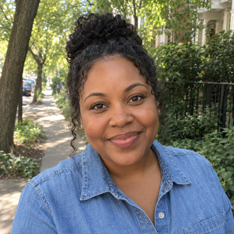
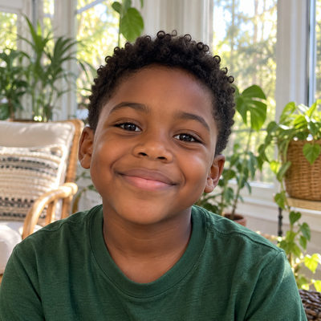

# Cruz Family

New household · 4 people · Phoenix campus · [source](../households/cruz.json)

Jose and Gabriela Cruz registered Adrian and Camila for Vacation Bible School this summer. They have not visited on a Sunday.

| Photo | Name | Age | Role | Status |
|---|---|---|---|---|
|  | Jose Cruz | 36 | adult | Participant |
|  | Gaby (Gabriela) Cruz | 35 | adult | Participant |
|  | Adrian Cruz | 8 | child | Participant |
|  | Camila Cruz | 6 | child | Participant |

## People

### Jose Cruz

- Age 36 · married · email jose.cruz@example.org · groups: Jenkins Group (group archived), Lee Group (left)
- Person Guid `CBE5E38E-4824-4472-904F-9BDCF77BD433`

### Gaby (Gabriela) Cruz

- Age 35 · married · email gaby.cruz@example.org · groups: Jenkins Group (group archived), Lee Group (left)
- Person Guid `4E98A87E-06B9-4822-9C45-88BF1F6E9C12`

### Adrian Cruz

- Age 8 · no email
- Person Guid `B2EE9FEF-78FF-443E-A7C6-C42816A07A80`

### Camila Cruz

- Age 6 · no email
- Person Guid `24E948DC-8304-4DF0-8003-876CB3D6DC71`

## What this family tests

- Participants through an event registration (VBS).
- Follow-up after a kids event.

## Activity

- **Attendance:** holiday-only, 0% of Sundays.
- **Giving units:** the couple gives together as one giving unit.
- **Giving:** none.

## Address

10686 W Runion Dr, Peoria, AZ 85382 (a real street with a house number that does not exist)

---

Generated by `cast/build-pages.js` from the household file. Edit the JSON, then rerun the script.
