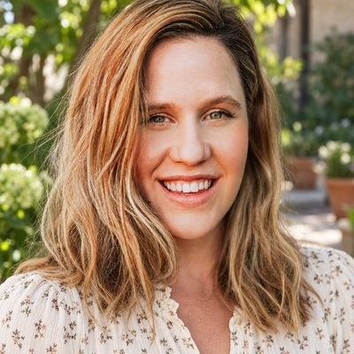

# Evans

Legacy household · 1 person · Phoenix campus · [source](../households/evans.json)

Helen Evans came to a very large event on campus and asked about serving in the children's ministry. Someone should follow up with her.

| Photo | Name | Age | Role | Status |
|---|---|---|---|---|
|  | Helen Evans | 44 | adult | Prospect |

## People

### Helen Evans

- Age 44 · single · email hevans@example.org · groups: Wright Group (left)
- Person Guid `1DFFF821-E97C-4324-9883-CF59B5C5BDD6`

## What this family tests

- Event guest who needs follow-up.
- Open connection request for children's ministry.

## Activity

- **Attendance:** set by connection status.
- **Giving:** none.

## Address

10826 N Biltmore Dr, Phoenix, AZ 85029 (a real street with a house number that does not exist)

## Open questions

- The legacy data gives Helen the same street address as the Simmons family. Confirm or change.

---

Generated by `cast/build-pages.js` from the household file. Edit the JSON, then rerun the script.
