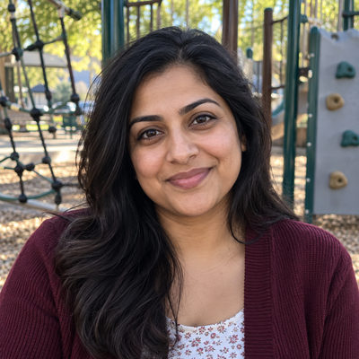
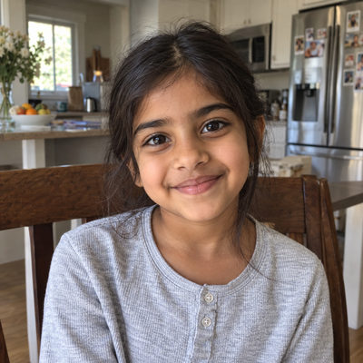
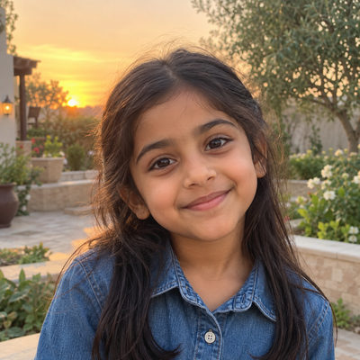
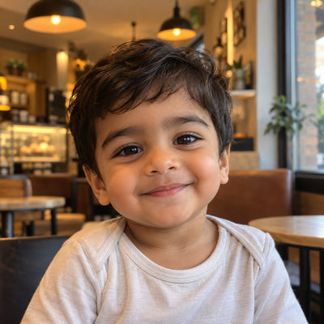

# Garcia Family

**Featured** · New household · 5 people · Phoenix campus · [source](../households/garcia.json)

Daniel and Maria Garcia have twin girls in first grade and a two-year-old son.

| Photo | Name | Age | Role | Status |
|---|---|---|---|---|
|  | Daniel Garcia | 35 | adult | Engaged |
|  | Maria Garcia | 34 | adult | Engaged |
|  | Olivia Garcia | 6 | child | Engaged |
|  | Bella (Isabella) Garcia | 6 | child | Engaged |
|  | Leo Garcia | 2 | child | Engaged |

## People

### Daniel Garcia

Daniel and his wife Maria have twin girls in first grade and a two-year-old son.

- Age 35 · married · no email · groups: Kids Ministry · business contact for Desert Bloom Landscaping
- Person Guid `83DAAFFE-41B0-4439-A958-F854589887E6`

### Maria Garcia

Maria gives monthly. She checks in all three kids every Sunday.

- Age 34 · married · email maria.garcia@example.org · groups: Kids Ministry · business contact for Desert Bloom Landscaping
- Person Guid `1AD452EF-23CE-4250-A1B1-34836452DEFB`

### Olivia Garcia

Olivia is one of the six-year-old twins. She and her sister share a birthday, which makes them useful for testing check-in search and duplicate-looking records.

- Age 6 · no email
- Person Guid `5E430E12-97F9-4AE9-8232-76C331313B38`

### Bella (Isabella) Garcia

Isabella (Bella) is Olivia's twin.

- Age 6 · no email
- Person Guid `0A5BAA4D-CD82-4F68-8272-99922074EE11`

### Leo Garcia

Leo is two and checks in to the toddler room.

- Age 2 · no email
- Person Guid `4BA2873B-25CC-4757-9ED3-037E631EDD95`

## What this family tests

- Twins with the same birthday.
- Toddler and K-1 check-in in one visit.
- Monthly giver.

## Activity

- **Attendance:** core, 80% of Sundays, since 5 years ago.
- **Giving:** **monthly** by Maria Garcia: $200 General Fund per gift, gives in 90% of periods, started 4 years ago.
- **Giving units:** the couple gives together as one giving unit.

## Address

15260 N 43rd St, Phoenix, AZ 85032 (a real street with a house number that does not exist)

---

Generated by `cast/build-pages.js` from the household file. Edit the JSON, then rerun the script.
