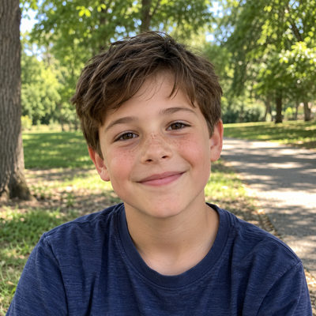
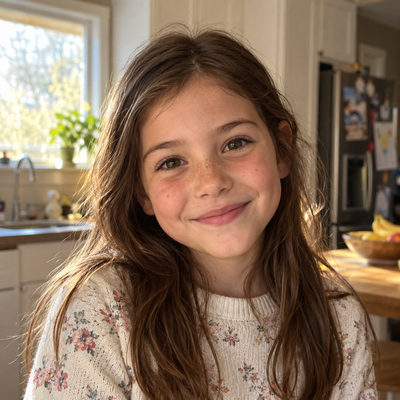

# Greggs

**Featured** · Legacy household · 4 people · Phoenix campus · [source](../households/greggs.json)

Robert and Lorraine Greggs lost their first child, Jenny, when she was three. They have two other children now. Jenny's record was moved to its own family and linked back to her parents.

| Photo | Name | Age | Role | Status |
|---|---|---|---|---|
|  | Bob (Robert) Greggs | 36 | adult | Leading |
|  | Lorraine Greggs | 36 | adult | Engaged |
|  | Tim (Timothy) Greggs | 10 | child | Engaged |
|  | Jordan Greggs | 9 | child | Engaged |

## People

### Bob (Robert) Greggs

Bob is an electrical engineer at Mesa Ridge Electronics. He and Lorraine host a small group in their home.

- Age 36 · married · Electrical Engineer, Mesa Ridge Electronics · email rgreggs@example.org · groups: Greggs Group (leader), First Aid Team, Russell Group (host, group archived)
- Person Guid `28C4F2C0-0691-468F-B40E-550BD2976B9E`

### Lorraine Greggs

Lorraine is a financial analyst at Mesa Ridge Electronics. She and Bob lost their first daughter, Jenny, at age three, and a staff note asks people to be gentle with her around that anniversary in September.

- Age 36 · married · Financial Analyst, Mesa Ridge Electronics · email lgreggs@example.org · groups: Greggs Group (host), Worship Team, Russell Group (host, group archived)
- Person Guid `1A5A4E5F-E0A4-4EFA-B7D7-6698153ED718`

### Tim (Timothy) Greggs

Tim is ten, born after Jenny. He has a younger sister, Jordan.

- Age 10 · unknown · email tgreggs@example.org
- Person Guid `5DB35E3C-8A84-488B-9738-FB3CACD4C517`

### Jordan Greggs

Jordan is nine and Tim's younger sister.

- Age 9 · unknown · no email
- Person Guid `BDF4A42D-5C22-4E73-868D-17DEF16280D9`

## What this family tests

- Grieving family with sensitive alert notes.
- Living children in the family; a deceased child linked by relationship.

## Activity

- **Attendance:** set by connection status.
- **Giving units:** the couple gives together as one giving unit.
- **Giving:** none.

## Prayer requests

- **Answered**, from Lorraine Greggs, about 7 months ago (Comfort/Grief, 8 prayers, 1 comments): This week is the anniversary of losing our daughter Jenny. Bob and I still feel it every year, and our kids are old enough now to ask about her. Please pray for comfort, and for the right words when they ask. Answer: The week was gentle. We told the kids stories about Jenny, and we even laughed. Thank you for carrying us.

## Address

10636 N 16th Ave, Phoenix, AZ 85029 (a real street with a house number that does not exist)

---

Generated by `cast/build-pages.js` from the household file. Edit the JSON, then rerun the script.
