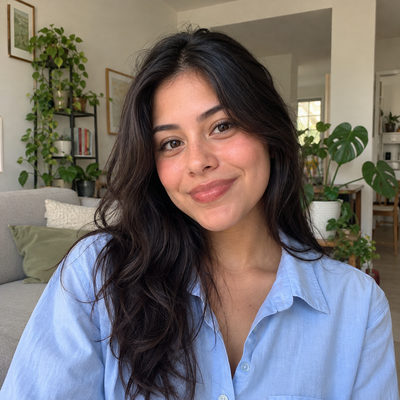

# Hall Family

New household · 1 person · Phoenix campus · [source](../households/hall.json)

Brianna Hall is a college freshman. She helped at a community serve day this fall but has not come on a Sunday yet. She took the Starting Point class on Wednesday nights last month, took the Spiritual Gifts assessment it asked for, and now waits as a Pending greeter.

| Photo | Name | Age | Role | Status |
|---|---|---|---|---|
|  | Bri (Brianna) Hall | 19 | adult | Participant |

## People

### Bri (Brianna) Hall

- Age 19 · single · email bri.hall@example.org · groups: Wright Group (left) · Rock shows Starting Point Class complete, Serve in progress
- Person Guid `3E7384C8-9E7A-407D-BE01-54C9A02B281F`

## What this family tests

- Participant: one in-person touch (a serve day), no Sunday attendance.
- Young adult living alone.
- Starting Point Class complete last month and a Serve step In Progress while she waits as a Pending greeter.
- Spiritual Gifts taken last month, from her Starting Point class, with gifts that fit a greeter: Hospitality, Encouragement, and Service are among her dominant gifts.

## Activity

- **Attendance:** holiday-only, 0% of Sundays.
- **Giving:** none.

## Address

11261 W Olive Dr, Avondale, AZ 85392 (a real street with a house number that does not exist)

---

Generated by `cast/build-pages.js` from the household file. Edit the JSON, then rerun the script.
