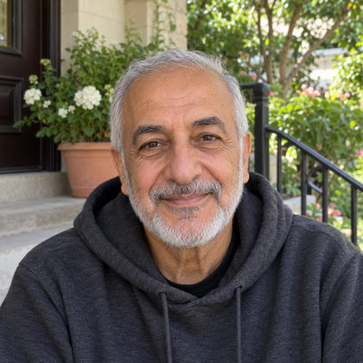
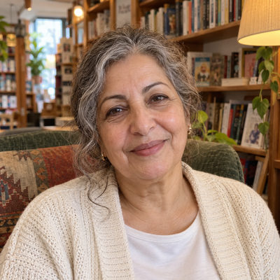

# Hayes Family

New household · 2 people · Phoenix campus · [source](../households/hayes.json)

Robert and Linda Hayes have been married 46 years and members for 25. They never miss the 9:00 service and give every week.

| Photo | Name | Age | Role | Status |
|---|---|---|---|---|
|  | Bob (Robert) Hayes | 70 | adult | Engaged |
|  | Linda Hayes | 68 | adult | Engaged |

## People

### Bob (Robert) Hayes

- Age 70 · married · email bob.hayes@example.org · groups: Marble Group
- Person Guid `468247EF-7A8B-4E02-9F23-C3BA98C74837`

### Linda Hayes

- Age 68 · married · email linda.hayes@example.org · groups: Marble Group
- Person Guid `A8CFFC26-2EAA-4B1D-9F1E-54071FD0C29A`

## What this family tests

- Senior couple with a long anniversary.
- Weekly giver to the General and Mission funds.

## Activity

- **Attendance:** core, 86% of Sundays, 96% at their usual service, since 25 years ago.
- **Giving:** **weekly** by Bob Hayes: $120 General Fund + $40 Mission Fund per gift, gives in 92% of periods, 30% chance of a year-end gift, started 24 years ago.
- **Giving units:** the couple gives together as one giving unit.

## Address

4581 E Horseshoe Rd, Phoenix, AZ 85028 (a real street with a house number that does not exist)

---

Generated by `cast/build-pages.js` from the household file. Edit the JSON, then rerun the script.
