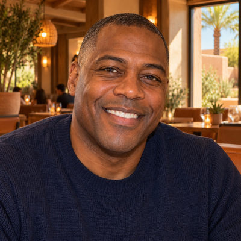
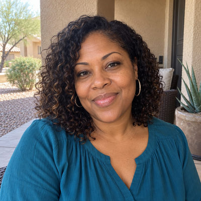

# Haywood Family

**Featured** · New household · 3 people · Phoenix campus · [source](../households/haywood.json)

Andre Haywood is the Peoria Campus Pastor. Keisha is an academic advisor at Sonoran Valley University, and their son Isaiah checks in to the Peoria student service.

| Photo | Name | Age | Role | Status |
|---|---|---|---|---|
|  | Andre Haywood | 48 | adult | Engaged |
|  | Keisha Haywood | 46 | adult | Engaged |
|  | Isaiah Haywood | 16 | child | Engaged |

## People

### Andre Haywood

Andre is the Peoria Campus Pastor. He joined staff four years ago and leads the West Valley campus.

- Age 48 · married · Peoria Campus Pastor, Rock Solid Church · email andre@rocksolidchurchdemo.com · 2 security roles
- Person Guid `DF911BBD-E3DA-4852-9C35-1A6F92A13558`

### Keisha Haywood

- Age 46 · married · Academic Advisor, Sonoran Valley University · email keisha.haywood@example.org
- Person Guid `8CA9CF2C-CBD7-449B-8857-CF013AA71E65`

### Isaiah Haywood

- Age 16 · email isaiah.haywood@example.org
- Person Guid `BCAA38E2-00EF-44AB-B38A-3B34CD159D07`

## What this family tests

- Named campus pastor at Peoria, loaded only in datasets with the Peoria campus.
- Cast family that lives at a campus other than the main one.
- High school student at a campus other than the main one.

## Activity

- **Attendance:** core, 93% of Sundays, since 4 years ago.
- **Giving:** **bi-weekly** by Andre Haywood: $160 General Fund per gift, gives in 92% of periods, started 4 years ago.
- **Giving units:** the couple gives together as one giving unit.

## Address

7473 W Banff Ln, Peoria, AZ 85381 (a real street with a house number that does not exist)

---

Generated by `cast/build-pages.js` from the household file. Edit the JSON, then rerun the script.
