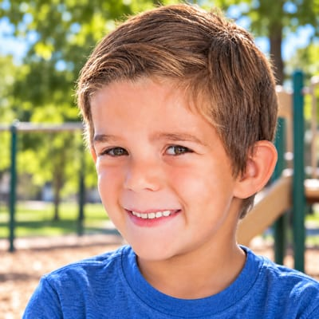

# Jones Family

**Featured** · Legacy household · 2 people · Phoenix campus · [source](../households/jones-ben.json)

Ben and Sarah Jones attended rarely and divorced. Ben now shares custody of their son Brian. Sarah later married Jim Simmons, and Brian lives mostly with them.

| Photo | Name | Age | Role | Status |
|---|---|---|---|---|
|  | Ben (Benjamin) Jones | 36 | adult | Known |
|  | Brian Jones | 6 | child | Connected |

## People

### Ben (Benjamin) Jones

Ben attended rarely before his divorce from Sarah, now Sarah Simmons. He shares custody of their son Brian and comes mostly on weekends when Brian is with him.

- Age 36 · single · email ben.jones@example.org · groups: Rivera Group, Greggs Group (left)
- Person Guid `3C402382-3BD2-4337-A996-9E62F1BAB09D`

### Brian Jones

Brian is six and belongs to two families: his dad Ben's and his mom Sarah's (the Simmons). He is the record to use for shared custody and for a child who appears in two households.

- Age 6 · single · email brian.jones@example.org
- Person Guid `3D7F6605-3666-4AB5-9F4E-D7FEBF93278E`

## What this family tests

- Divorced parent with joint custody; the child belongs to two families.
- Lapsed attender (stopped after the divorce).
- Step-parent relationship from the other side.

## Activity

- **Attendance:** lapsed, 20% of Sundays, 50% at their usual service, since 11 years ago, stopped 10 years ago.
- **Giving:** none.

## Address

10603 N 32nd Dr, Phoenix, AZ 85029 (a real street with a house number that does not exist)

---

Generated by `cast/build-pages.js` from the household file. Edit the JSON, then rerun the script.
