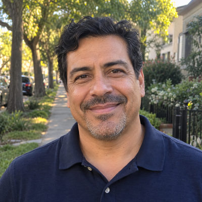
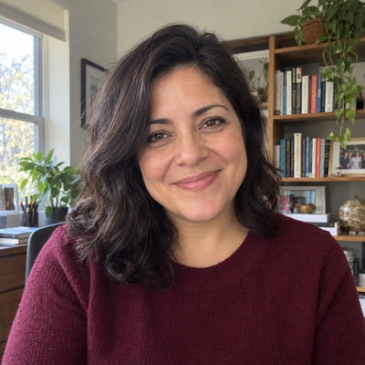

# Kim Family

New household · 3 people · Phoenix campus · [source](../households/kim.json)

David and Susan Kim's son Andrew is 20, in college, and still lives at home.

| Photo | Name | Age | Role | Status |
|---|---|---|---|---|
|  | David Kim | 50 | adult | Connected |
|  | Susan Kim | 49 | adult | Connected |
|  | Drew (Andrew) Kim | 20 | adult | Connected |

## People

### David Kim

- Age 50 · married · email david.kim@example.org · groups: Marble Group
- Person Guid `9CF4024D-2D36-4F97-89C4-8BE09B39C72A`

### Susan Kim

- Age 49 · married · email susan.kim@example.org · groups: Marble Group
- Person Guid `884B43EB-4A3A-47E9-85A4-51D7AE850D61`

### Drew (Andrew) Kim

- Age 20 · single · Sonoran Valley University · no email · groups: Foster Group
- Person Guid `3A0B5DA0-9CB1-40C7-8A16-FCBDF24F8A33`

## What this family tests

- Adult child living at home (adult role in the family).
- Monthly giver.
- An adult son at home gives on his own (his own giving unit).

## Activity

- **Attendance:** regular, 55% of Sundays, since 9 years ago.
- **Giving:** **monthly** by David Kim: $200 General Fund per gift, gives in 90% of periods, started 8 years ago.
- **Giving:** **occasional** by Drew Kim: $25 General Fund per gift, gives in 70% of periods, started a year ago.
- **Giving units:** the couple gives together as one giving unit.
- **Giving units:** Drew Kim is a separate giving unit.

## Address

26867 N 83rd Dr, Peoria, AZ 85383 (a real street with a house number that does not exist)

---

Generated by `cast/build-pages.js` from the household file. Edit the JSON, then rerun the script.
