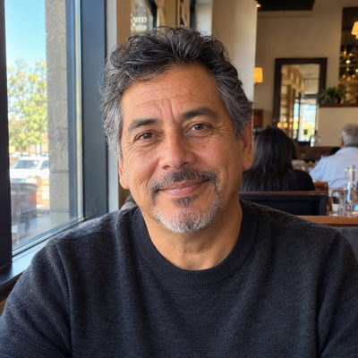
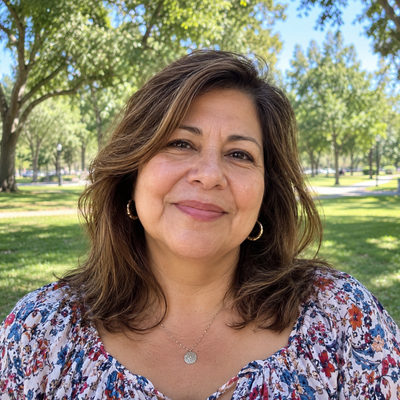

# Morgan Family

New household · 2 people · Phoenix campus · [source](../households/morgan.json)

Steve and Karen Morgan are empty nesters. Steve gives once a quarter after his business closes its books, plus a year-end gift.

| Photo | Name | Age | Role | Status |
|---|---|---|---|---|
|  | Steve (Steven) Morgan | 58 | adult | Engaged |
|  | Karen Morgan | 57 | adult | Engaged |

## People

### Steve (Steven) Morgan

- Age 58 · married · email steve.morgan@example.org · groups: Silva Group, Jenkins Group (group archived), Foster Group (left) · business contact for Mesquite Tree Bookkeeping
- Person Guid `26ECA7AC-9EF7-403A-B053-C852CBA7DB4C`

### Karen Morgan

- Age 57 · married · email karen.morgan@example.org · groups: Silva Group, Jenkins Group (group archived), Foster Group (left)
- Person Guid `4CB52244-023C-46BA-8C3A-FA24D9611ADF`

## What this family tests

- Quarterly giver with a year-end gift.
- Empty nesters.

## Activity

- **Attendance:** regular, 72% of Sundays, since 18 years ago.
- **Giving:** **quarterly** by Steve Morgan: $1,500 General Fund per gift, gives in 100% of periods, 80% chance of a year-end gift, started 15 years ago.
- **Giving units:** the couple gives together as one giving unit.

## Prayer requests

- **Waiting**, from Karen Morgan, 1 days ago (Travel): Steve and I are driving to Colorado this weekend to see our daughter and the grandkids. Safe travels, please, and a sweet visit.

## Address

6296 W Willow Ave, Glendale, AZ 85304 (a real street with a house number that does not exist)

---

Generated by `cast/build-pages.js` from the household file. Edit the JSON, then rerun the script.
