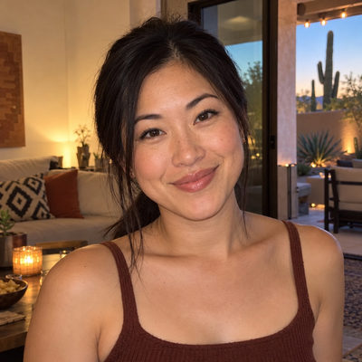
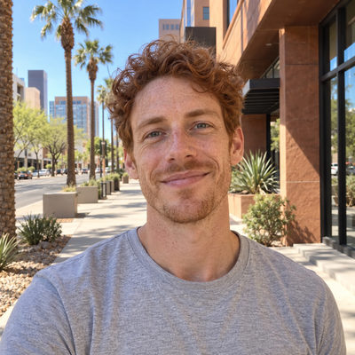

# Morrow Family

**Featured** · New household · 2 people · Phoenix campus · [source](../households/morrow.json)

Kelsey Morrow is the Production Director. She runs sound, lights, and streaming at every campus and trains each campus's production volunteers. Evan teaches science at Palo Verde Technical College.

| Photo | Name | Age | Role | Status |
|---|---|---|---|---|
|  | Kelsey Morrow | 31 | adult | Engaged |
|  | Evan Morrow | 32 | adult | Engaged |

## People

### Kelsey Morrow

Kelsey is the Production Director. She joined staff two years ago and runs sound, lights, and streaming at every campus.

- Age 31 · married · Production Director, Rock Solid Church · email kelsey@rocksolidchurchdemo.com · 1 security roles
- Person Guid `2D46542F-54ED-4511-AD8F-A4F7E887A11B`

### Evan Morrow

- Age 32 · married · Science Instructor, Palo Verde Technical College · email evan.morrow@example.org
- Person Guid `9FCC03D5-8D77-4386-87EF-3E42CBAFE3C8`

## What this family tests

- Production Director who oversees every campus's production team.
- Mixed couple with no children.

## Activity

- **Attendance:** core, 96% of Sundays, since 2 years ago.
- **Giving:** **bi-weekly** by Kelsey Morrow: $90 General Fund per gift, gives in 90% of periods, started 2 years ago.
- **Giving units:** the couple gives together as one giving unit.

## Address

12419 N 71st Dr, Peoria, AZ 85381 (a real street with a house number that does not exist)

---

Generated by `cast/build-pages.js` from the household file. Edit the JSON, then rerun the script.
