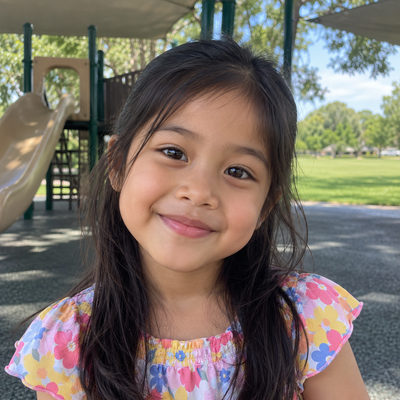

# Ramirez Family

**Featured** · New household · 4 people · Phoenix campus · [source](../households/ramirez.json)

The Ramirez family visited for the first time two weeks ago and came back last Sunday. Lucas and Mia checked in to the elementary rooms.

| Photo | Name | Age | Role | Status |
|---|---|---|---|---|
|  | Carlos Ramirez | 37 | adult | Prospect |
|  | Ana Ramirez | 36 | adult | Prospect |
|  | Lucas Ramirez | 9 | child | Prospect |
|  | Mia Ramirez | 6 | child | Prospect |

## People

### Carlos Ramirez

Carlos and his wife Ana visited for the first time two weeks ago and came back last Sunday. They are Prospects who need a follow-up.

- Age 37 · married · email carlos.ramirez@example.org
- Person Guid `D41605ED-1652-421F-AC36-39DA3FE714E2`

### Ana Ramirez

Ana filled out a connection card on the family's first visit.

- Age 36 · married · no email
- Person Guid `112ECC26-08DF-4257-810E-7C848227519B`

### Lucas Ramirez

Lucas is nine and checked in for the first time two weeks ago.

- Age 9 · no email
- Person Guid `3948E813-51A9-40C0-B5C2-BF13192906BC`

### Mia Ramirez

Mia is six and checked in for the first time with her brother.

- Age 6 · no email
- Person Guid `7A22C85E-90FE-49EE-AC02-0FD83076208D`

## What this family tests

- First-time guests: first visit two weeks ago.
- Prospect family that needs follow-up.
- First-time check-in for two kids.

## Activity

- **Attendance:** regular, 100% of Sundays, since 14 days ago.
- **Giving units:** the couple gives together as one giving unit.
- **Giving:** none.

## Address

9 W North Ln, Phoenix, AZ 85021 (a real street with a house number that does not exist)

---

Generated by `cast/build-pages.js` from the household file. Edit the JSON, then rerun the script.
