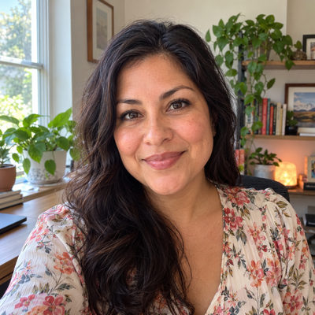
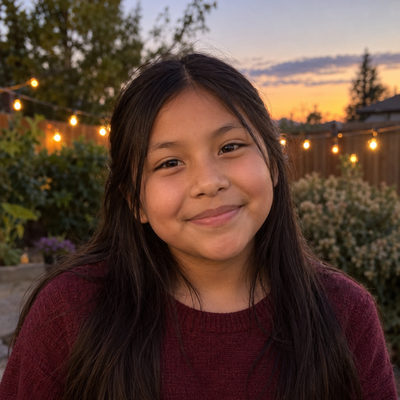

# Rivera Family

New household · 3 people · Phoenix campus · [source](../households/rivera.json)

Michael and Jennifer Rivera adopted Joy when she was three. Joy is now ten.

| Photo | Name | Age | Role | Status |
|---|---|---|---|---|
|  | Mike (Michael) Rivera | 44 | adult | Leading |
|  | Jen (Jennifer) Rivera | 43 | adult | Engaged |
|  | Joy Rivera | 10 | child | Engaged |

## People

### Mike (Michael) Rivera

- Age 44 · married · email mike.rivera@example.org · groups: Rivera Group (leader), Student Ministry, Murphy Group (group ended)
- Person Guid `A8002793-F4F2-425A-B68E-8BE8017EAEAC`

### Jen (Jennifer) Rivera

- Age 43 · married · email jen.rivera@example.org · groups: Rivera Group (host), Student Ministry, Murphy Group (group ended)
- Person Guid `17415CFB-C1A6-422E-B23E-D695BE0171C0`

### Joy Rivera

- Age 10 · no email
- Person Guid `9E20DE2D-9152-4094-8708-BCEA879AED62`

## What this family tests

- Adopted child whose photo ethnicity is set on her own record.
- Monthly scheduled giver.

## Activity

- **Attendance:** regular, 75% of Sundays, since 6 years ago.
- **Giving:** **monthly** by Jen Rivera: $120 General Fund per gift, gives in 95% of periods, started 6 years ago.
- **Giving units:** the couple gives together as one giving unit.

## Address

3149 W Yucca St, Phoenix, AZ 85029 (a real street with a house number that does not exist)

---

Generated by `cast/build-pages.js` from the household file. Edit the JSON, then rerun the script.
