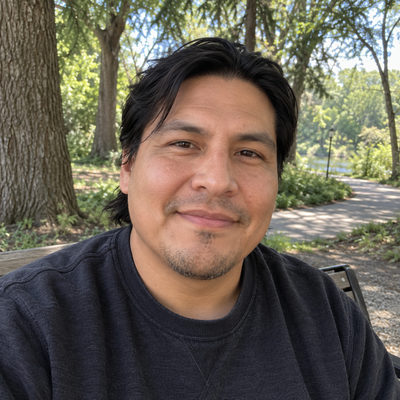
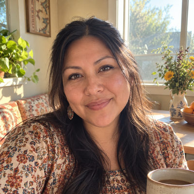
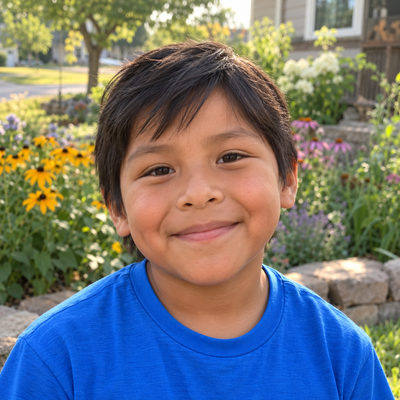
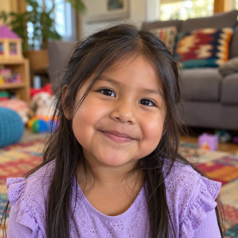

# Shaw Family

New household · 4 people · Phoenix campus · [source](../households/shaw.json)

Andrew and Lauren Shaw moved from Denver eight months ago and joined after trying a few churches.

| Photo | Name | Age | Role | Status |
|---|---|---|---|---|
|  | Andy (Andrew) Shaw | 38 | adult | Connected |
|  | Lauren Shaw | 37 | adult | Connected |
|  | Owen Shaw | 7 | child | Connected |
|  | Ella Shaw | 4 | child | Connected |

## People

### Andy (Andrew) Shaw

- Age 38 · married · no email · groups: Rivera Group
- Person Guid `93719445-07BF-4B1F-85E5-2838BF66A13B`

### Lauren Shaw

- Age 37 · married · email lauren.shaw@example.org · groups: Rivera Group
- Person Guid `EA03C61D-F6B3-4B00-8028-5BC86F24CA09`

### Owen Shaw

- Age 7 · no email
- Person Guid `C7AB4E87-EF23-4B2E-BFD5-BFDCB77FEB1F`

### Ella Shaw

- Age 4 · no email
- Person Guid `8C859873-811C-4050-91B5-C95B7D1F2247`

## What this family tests

- Transfer family from another church.
- New bi-weekly giver.

## Activity

- **Attendance:** regular, 65% of Sundays, since about 8 months ago.
- **Giving:** **bi-weekly** by Andy Shaw: $70 General Fund per gift, gives in 92% of periods, started about 7 months ago.
- **Giving units:** the couple gives together as one giving unit.

## Address

3078 W Sands Dr, Phoenix, AZ 85027 (a real street with a house number that does not exist)

---

Generated by `cast/build-pages.js` from the household file. Edit the JSON, then rerun the script.
