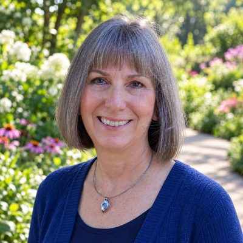

# Tennant Family

Legacy household · 2 people · Phoenix campus · [source](../households/tennant.json)

Rob and Sheryl Tennant are a married couple who attend and are in a small group. Sheryl is a little older than Rob.

| Photo | Name | Age | Role | Status |
|---|---|---|---|---|
|  | Rob (Robert) Tennant | 56 | adult | Connected |
|  | Sheryl Tennant | 58 | adult | Connected |

## People

### Rob (Robert) Tennant

- Age 56 · married · Supply Manager, Palo Verde Technical College · email rtennant@example.org · groups: Wright Group (left)
- Person Guid `8DE6710B-BDAB-4617-AE0C-83E77D3E77CC`

### Sheryl Tennant

- Age 58 · married · Art Director, ACME Art · email stennant@example.org · groups: Wright Group (left)
- Person Guid `773AD0F9-369A-47BC-BEBB-2E8EE4C5FEF5`

## What this family tests

- Married couple with different employers.
- Spouses give separately, each from their own employer paycheck.
- Open request to serve that Alisha Marble connects (In Progress).

## Activity

- **Attendance:** set by connection status.
- **Giving:** **monthly** by Rob Tennant: $180 General Fund per gift, gives in 92% of periods, started 12 years ago.
- **Giving:** **irregular** by Sheryl Tennant: $75 General Fund + $25 Mission Fund per gift, gives in 75% of periods, started 10 years ago.
- **Giving units:** the spouses give separately; each is their own giving unit.

## Address

11460 N 30th Ln, Phoenix, AZ 85029 (a real street with a house number that does not exist)

---

Generated by `cast/build-pages.js` from the household file. Edit the JSON, then rerun the script.
