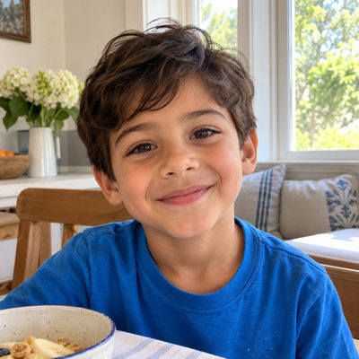
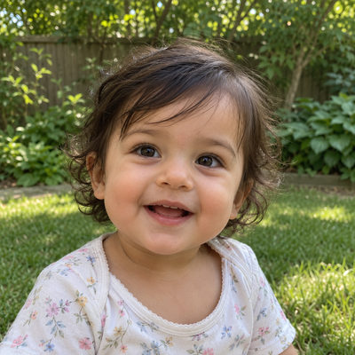

# Ward Family

New household · 4 people · Phoenix campus · [source](../households/ward.json)

Derek and Kayla Ward gave a single large gift after the church helped them through a hard year.

| Photo | Name | Age | Role | Status |
|---|---|---|---|---|
|  | Derek Ward | 34 | adult | Connected |
|  | Kayla Ward | 33 | adult | Connected |
|  | Aiden Ward | 5 | child | Connected |
|  | Nora Ward | 1 | child | Connected |

## People

### Derek Ward

- Age 34 · married · email derek.ward@example.org · groups: Lee Group
- Person Guid `5EFB0260-BF0A-491F-A4D5-C1205DCECB11`

### Kayla Ward

- Age 33 · married · email kayla.ward@example.org · groups: Lee Group
- Person Guid `AE71B1A1-1FE8-4FA4-AFF2-1ABA57D40592`

### Aiden Ward

- Age 5 · no email
- Person Guid `F3DC257E-B60E-45A2-9C01-43BA0C55928F`

### Nora Ward

- Age 1 · no email
- Person Guid `BCF9FC7B-D1E7-473E-8946-A91205C194BB`

## What this family tests

- One-time giver.
- Nursery and preschool check-in.

## Activity

- **Attendance:** occasional, 45% of Sundays, since 2 years ago.
- **Giving:** **one-time** by Derek Ward: $500 General Fund per gift, started a year ago.
- **Giving units:** the couple gives together as one giving unit.

## Address

5544 W Cinnabar Ave, Glendale, AZ 85302 (a real street with a house number that does not exist)

---

Generated by `cast/build-pages.js` from the household file. Edit the JSON, then rerun the script.
