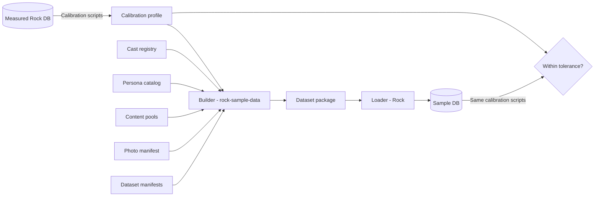

# Sample Data Redesign

> This spec started in the Rock repository (`specs/261015-sample-data-redesign.md`) and moved here with the project on 2026-10-15. The decision log in [decisions.md](decisions.md) records everything decided since; where the two differ, the decision log wins.

## Summary

Rock's sample data is slow to install, covers few features, and does not look like a real church. This spec replaces it with three datasets built from one shared set of people (the Cast) plus generated households (the Crowd). The data installs in bulk, its dates always end on install day, and its behavior (giving, attendance, groups, and more) is calibrated against measured Rock data. A knowledge framework in this repository keeps every decision and every number in data files, so new information updates the data instead of forcing a redesign.

## Motivation

- **Install is slow.** The current loader (`Rock/Bulk/SampleData/SampleDataManager.cs`) saves one entity at a time through the full Rock model. This makes it too slow for frequent test runs.
- **Coverage is thin.** Many features (connections, prayer, communications, registrations, serving) have little or no data, so testers and demo users see empty screens.
- **The data is not realistic.** Real giving has weekly, bi-weekly, monthly, and erratic givers, a December spike, and a few large givers. Real attendance has Easter peaks and holiday dips. Random data hides bugs that only real patterns expose, and it makes demos look fake.
- **Dates go stale.** Data with fixed dates falls out of "last 12 months" reports.
- **Knowledge gets lost.** Each past effort started over. This one must keep what we learn.

## Requirements

### Datasets

- MUST provide three datasets:

| Dataset | People | Campuses | Primary users |
|---|---|---|---|
| **Core 1** | The Cast only (about 80 households, 250 people) | 1 | Automated tests, core developers |
| **Core 3** | The Cast plus campus companions | 3 | Campus-aware testing, plugin developers |
| **Full 7** | The Cast plus the Crowd (about 25,000 people) | 7 | Demo sites, sales, reports, performance |

- The Cast MUST be identical in all three datasets: same people, same Guids, same stories, all on the main campus.
- The extra campuses MUST hold different people. In Core 3 these are a small set of generated "campus companion" households. In Full 7 they are part of the Crowd.
- MUST keep Rock Solid Church and today's sample personas (for example, the Decker family) as part of the Cast.

### Install

- MUST install into a fresh Rock database only. Installing into a database with real data is out of scope.
- Core 1 SHOULD load in under 10 seconds. Automated tests SHOULD restore a database snapshot of Core 1 in a few seconds.
- Full 7 SHOULD install in 2 to 3 minutes, and MUST install in under 5.
- MUST tag every inserted row with a `ForeignKey` value that names the dataset and version (for example `SampleData:Full7:1`), so sample records are always identifiable.

### Dates

- Every date MUST be relative to an anchor date. The anchor defaults to install day.
- Tests MAY pin the anchor date to get identical data on every run.
- Dates MUST follow the real calendar: services on real Sundays (and real midweek nights), Easter on its real date, Christmas Eve on December 24, Thanksgiving and July 4 dips, back-to-school spikes, and scheduled gifts on paydays (the 1st and 15th).
- Ages and grades MUST stay constant relative to the anchor. A child who is in 3rd grade on install day is always in 3rd grade.

### Realism

- Data MUST be coherent across features. Every household follows one journey, and all of its records (giving, attendance, groups, serving, steps, connections) come from that journey.
- Behavior MUST be calibrated against measured data through the calibration profile (see Design).
- Generated data MUST pass the validation loop: the same calibration scripts used for calibration MUST produce results within tolerance of the profile.
- Records MUST have realistic gaps (missing emails, phones, birthdates), at rates taken from the calibration profile.

### Connection statuses

- MUST use six connection statuses: **Prospect, Participant, Known, Connected, Engaged, Leading.**
- Each status MUST match the person's data. For example, a "Leading" person leads a group or team in the data.

### Photos

- Each Cast adult MUST carry a **photo ethnicity** in a `photo` block, used only to generate photos so spouses and children look like one family. Children inherit a blend of their parents unless set explicitly (for example, adoption).
- Photo ethnicity MUST NOT be written to Rock (not to `RaceValueId`, `EthnicityValueId`, or any attribute). It exists only in the Cast files, the photo manifest, and the builder.
- Photo ethnicity SHOULD be kept after photos are generated, so photos can be regenerated deterministically.
- Legacy Cast people MUST stay recognizable. Their portraits were redone once from the original photos (decision 32) and are never regenerated again.
- Names MUST NOT depend on photo ethnicity.
- About 15% of couples SHOULD be mixed, more among younger couples. The overall mix SHOULD be broader than the Phoenix area.
- People photos MUST look like casual social media profile pictures in varied everyday settings (about half outdoors, half indoors), not studio portraits. See `photos/README.md`, "Photo style."
- Photo coverage MUST be set per dataset. The Cast SHOULD show a healthy, complete picture, so coverage is high. Full 7 SHOULD use lower coverage to protect install time.
- Scanned check images SHOULD be drawn at install from fictional check templates, only for recent checks, so each image matches its gift.

### Content standards

- All people, churches, and organizations MUST be fictional. No real church names may appear anywhere in the repository, including calibration sources.
- Emails MUST use reserved domains (for example `example.org`). Phone numbers MUST use reserved ranges (555-0100 to 555-0199).
- Text content (prayer requests, notes, group names, communications) MUST be realistic but appropriate for a general audience: no graphic content, no political content, no mockery of any group.
- Names MUST come from broad public-domain name frequency data (for example U.S. Census surnames and SSA first names).
- Photos MUST be licensed for redistribution with Rock. People photos are AI-generated with a generator whose license allows redistribution, and MUST be screened so no face resembles a real or famous person.
- Check images MUST use fictional banks and invalid routing and account numbers.
- Raw calibration exports from real churches MUST NOT be committed. Only anonymized, normalized ratios may enter the repository.

### Framework

- All knowledge (target numbers, Cast stories, personas, content, dataset definitions) MUST live in versioned data files in this repository (`rock-sample-data`), not in code.
- The builder MUST live in this repository. Rock MUST NOT reference this repository.

## Design

### Overview



The builder runs offline and produces a dataset package. The loader runs inside Rock and installs it. The same calibration scripts measure both the sources and our own output, which closes the loop.

### Knowledge framework

```
rock-sample-data/
  README.md             How the pieces fit together
  calibration/
    sql/                Calibration scripts (run against any Rock database)
    profiles/           Calibration profiles: target numbers with source and date
    raw/                Local only. Git ignores everything here.
  cast/
    households/         One file per Cast household
  configuration/        Campuses, connection statuses, group types, accounts, check-in
  datasets/             Dataset manifests (Core 1, Core 3, Full 7)
  content/              Fonts for check images, and later text pools (prayer requests, notes, messages)
  addresses/            The address pool and its builder
  photos/               Photo contract, manifest, and delivered Cast and pool photos
  docs/                 Strategy, decisions, roadmap, contributing, the Crowd and personas, and this spec
  builder/              The builder: writes one dataset package per dataset
  loader/               The loader library: installs a package into Rock
  loader-cli/           The loader's command line, for developers and test harnesses
  validation/           Tolerances and the validation runner
```

When new information arrives (for example, a new calibration source), the workflow is: run the calibration scripts, update or add a profile, rebuild, and let validation confirm the result. No redesign needed.

### Calibration profile

Calibration has two layers:

1. **Sources.** `normalize.js` turns calibration script output into an anonymous source file of ratios (per giving unit, per family, per week, per 1,000 active adults). It drops anything that could identify a source: group type names, custom statuses, URLs, campus counts, and exact totals. Sources use neutral labels (`source-1`) and are never named or described anywhere in the repository, including commit history.
2. **Profiles.** A profile is a short recipe: which sources to blend and by what weight, which values to exclude, and which to override. Every exclusion and override records its reason. Values with no source are marked "Assumption."

```json
{
  "profile": "sample-church",
  "blend": [ { "source": "source-1", "weight": 1 } ],
  "excluded": [ { "path": "giving.sourceMix.other", "reason": "Church-specific online giving portal." } ],
  "overrides": [ { "path": "giving.pctUnitsWithPledge", "value": 12, "reason": "Assumption. The sample data must exercise pledge features." } ]
}
```

`resolve-profile.js` produces the effective targets. Quirks that do not fit a typical sample church (custom statuses, communication-list groups, record bloat, automation volume) are excluded or overridden in the profile, never edited in the source. Overrides can also hold coarse, rounded targets that record no source at all.

### Cast registry

One file per Cast household. Each file holds:

- A stable household Guid and stable person Guids.
- The household story and **test purpose** (what it exists to exercise, for example "blended family with kids in two households" or "duplicate pair for merge testing").
- Members with relative ages, roles, and personas.
- Journey milestones as offsets from the anchor date.
- Photo ethnicity per person, in a `photo` block (never written to Rock).

Tests and documentation may rely on Cast people by Guid. Changing a Cast member's data is a breaking change for those tests and must be reviewed as one.

The format is defined by `cast/household.schema.json` and `group.schema.json`. Group membership lives only in group files. `validate-cast.js` checks Guids, required fields, every cross-reference, and that each person's connection status matches their data. The 38 legacy families are already converted; `cast/INVENTORY.md` lists their open issues and the gaps the new households should fill.

### Household journey and connection statuses

Each household follows a journey whose stages map to connection statuses:

| Status | Meaning |
|---|---|
| Prospect | Created from a web or mobile form (online gift, sign-up, app registration). Contact details only. |
| Participant | Took part in one thing in person (a kids event, a class, a serve day). Not really known yet. |
| Known | Has visited. We know who they are. |
| Connected | Attends regularly. |
| Engaged | In a group, serving, or giving. |
| Leading | Leads a group or a team. |

Journeys move forward, stall, or lapse over time. The loader generates each household's records from its journey, so status and data always agree.

Rock code refers to some system connection statuses by Guid (for example, `Person.SaveHook.cs` assigns Visitor when a status is missing, and about 20 web and mobile forms default to Prospect). The sample configuration therefore renames system values instead of deleting them:

| Rock system value | Sample data name |
|---|---|
| Participant | Participant (unchanged) |
| Visitor | Known |
| Attendee | Connected |
| Member | Engaged |
| (new value) | Leading |
| Prospect | Prospect (unchanged) |

Keeping Prospect means every code path that assigns a system status lands on one of the six sample statuses. No system value is hidden or deleted.

### Personas

Personas are behavior templates. Their numbers come from the calibration profile.

- **Giving:** one time, occasional, weekly, bi-weekly or twice monthly, monthly, quarterly, irregular, year-end, lapsing, new. Each has an amount pattern (steady or variable, round-number tendency), a payment method mix, and a scheduled versus one-time mix.
- **Attendance:** core, regular, occasional, holiday-only, lapsing. Children check in with their parents' attendance, in age-appropriate areas.
- **Engagement:** group member, group leader, serving, serving lead.

### Package and loader

The package stores **who people are**: households, people, relationships, journeys, personas, and photo assignments. The loader generates **what people did** (gifts, attendance, check-ins, group attendance, communications, prayer, connections) at install time, using a seeded, calendar-aware timeline engine.

The loader is one library, published to NuGet and called by Rock's installer and by a command line for test harnesses (decision 41). It contains only a generic, data-driven engine. All church-specific knowledge arrives in the package. Each package is for one Rock major release, read from Rock's `Rock.Version.dll` (decision 52).

Load steps:

1. Confirm the database is fresh and the package matches the Rock version.
2. Load configuration (campuses, statuses, group types, accounts, check-in) through Rock's services. These are few rows and need full model behavior.
3. Load people and households with `SqlBulkCopy`, using pre-assigned Ids (offset from the current maximum Id per table).
4. Generate timelines in memory and bulk-load them.
5. Run set-based fix-ups for logic that bulk insert skips (primary family, giving leader, age brackets, persisted attribute values).
6. Clear caches.

### Addresses and campuses

The sample church is in the Phoenix area. Addresses use **real streets with house numbers that do not exist**, so no real household ever appears in sample data.

- **Street data:** U.S. Census TIGER/Line address ranges (public domain) give every street segment, its valid house numbers, and its coordinates.
- **Avoiding real homes:** Maricopa County address points show which house numbers exist. They are used only to find residential areas and to skip real numbers. They are never committed or shipped.
- **Placement:** for each household, the builder draws a distance from the calibrated distance-to-campus pattern, picks a direction weighted toward residential areas, snaps to a real residential street, and chooses a valid, unused house number. Coordinates are interpolated along the street segment, the same way the Census geocoder works.
- **Campus choice:** the calibrated share of families who attend their nearest campus decides how many households may live closer to a different campus.
- **Output:** a committed address pool (about 10,000 addresses for Full 7). Downloaded source data stays local.
- **Tradeoff:** strict USPS verification (for example, Smarty) reports these addresses as undeliverable. Installs do not run verification, and coordinates ship with the data.
- **Legacy Cast addresses** are real homes. Each moves to an unused number on the same street, which keeps its neighborhood and distance.
- **Calibration:** `Report_SampleDataCalibration_4_DistanceToCampus.sql` returns family counts per grid cell (about 0.7 miles, cells under 5 families suppressed) and exact campus locations. It does no distance math on the church's server. `distance-from-cells.js` computes distance bands, percentiles, nearest-campus share, and campus spacing locally.
- **Targets:** distance targets are coarse, rounded values in the profile with no source recorded. Only the pattern is used; no measured neighborhood ever shapes where sample households go.

Campuses are named by city only, with no "Campus" suffix. The main campus is Rock's built-in main campus, renamed **Phoenix** and placed in North Phoenix, where the legacy Cast lives.

| Dataset | Campuses |
|---|---|
| Core 1 | Phoenix |
| Core 3 | Adds Peoria and Gilbert, with 75 generated companion households each |
| Full 7 | Adds Scottsdale, Chandler, Goodyear, and Tempe (the urban, young-adult campus, chosen over downtown Phoenix so every name is a city) |

### Photos

- The photo set is produced separately. This spec defines only the contract.
- The photo manifest lists each image with: file name, photo ethnicity, gender, age band, generation seed, generator version, and license reference.
- A single file in `photos/` holds the prompt wording for each photo ethnicity, so wording is tuned in one place. The field is `photo.ethnicity`, with ten broad regional groups rather than country-level ones (decision 29 in [decisions.md](decisions.md)).
- Children of parents with different photo ethnicities use a blended (multiracial) prompt.
- The Crowd draws from a shared photo pool, never reusing a face within a family or campus.
- Starting coverage targets, tunable per dataset manifest:

| Dataset | Adults with photo | Children with photo |
|---|---|---|
| Cast (all datasets) | 100% | 90% |
| Core 3 companions | 50% | 50% |
| Full 7 Crowd | 0% (Full 7 shows the Cast photos only) | 0% |

### Testing integration

In the Rock repository, `Rock.Tests.Integration` already builds database container images from sample data (`Rock.Tests.Integration/TestFramework/database/DatabaseContainerImageBuilder.cs`, `Rock.Tests.Integration/TestFramework/database/Initializer/SampleDataset.cs`). Core 1 SHOULD plug into that path, so tests restore a prebuilt image instead of loading data each run.

### Rollout

1. **Phase 0 (spike):** people and families, giving, and Sunday attendance with kids check-in, for Core 1. Prove load speed, correctness in the Rock UI, and the validation loop.
2. **Phase 1:** groups, serving, registrations, prayer, communications, connections. Core 3.
3. **Phase 2:** Full 7 and the remaining features (steps, LMS, interactions, workflows, and others).

The current XML sample data and `SampleDataManager` stay in place until the new loader reaches parity.

## Open Questions

1. **Package hosting.** Where do packages live? (Today's XML is hosted on storage.rockrms.com.) Full 7 with photos may reach a few hundred megabytes.
2. **Photo storage.** Store images in the database or through a file-system storage provider? This affects Full 7 install time.
3. **Loader placement.** Does the new loader replace the internals of `SampleDataManager`, or live beside it? Any new namespace needs approval.
4. **Status definitions.** Confirm the meaning of each of the six connection statuses in the journey table.

## Considered but Rejected

### Ship a database backup as the dataset
Rejected. A backup is tied to one exact schema version and cannot install into other versions. Test snapshots are still used, but they are built from the package.

### Shift every stored date by N days at install
Rejected. Sundays, holidays, and paydays drift onto the wrong days, and seasonal patterns land in the wrong months.

### Store the full timeline in the package
Rejected. The data goes stale, and seasonality is only correct on the day the package is built.

### Generate everything at install, including people
Rejected. Without a stored, reviewed Cast, tests and documentation cannot rely on specific people.

### Insert through Rock services, as today
Rejected for high-volume data. It is the reason today's install is slow. Services are still used for configuration rows.

### Use real home addresses
Rejected. A real Phoenix home would show a fictional person, possibly with a failed background check or a deceased child, on public demo sites. Real streets with unused house numbers keep maps and distances accurate without that risk.

### Use Rock's race and ethnicity fields for photo matching
Rejected. It would write sensitive demographic data into sample records, and the need is only visual consistency inside a family.

### Tie names to photo ethnicity
Rejected. It would stereotype people.

### Wait for many churches' data before starting
Rejected. Calibration data is hard to collect. The profile and validation loop absorb new sources as they arrive.

## Related

- `Rock/Bulk/SampleData/SampleDataManager.cs` (current loader)
- `Rock.Blocks/Example/SampleData.cs` (current sample data block; loads XML from storage.rockrms.com)
- Rock repository: `Rock.Tests.Integration/TestFramework/database/Initializer/SampleDataset.cs` (test database images)
- `calibration/sql/` (calibration scripts)
