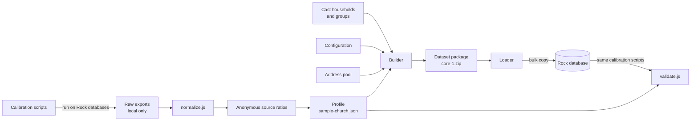

# How it works

This page follows the data from the files in this repository to a loaded Rock database.

## The pipeline

1. **Measure.** The calibration scripts run inside a Rock database and return only anonymous counts and ratios.
2. **Normalize.** `calibration/normalize.js` turns that output into a source file of ratios. Raw exports never leave the git-ignored `calibration/raw/` folder.
3. **Blend.** A profile (`calibration/profiles/sample-church.json`) blends one or more sources into target numbers, and records each exclusion and override with a reason. `resolve-profile.js` produces the final numbers.
4. **Pack.** The [builder](../builder/README.md) reads the Cast, the configuration, the address pool, the photos, and the resolved profile, and writes one package per dataset for one exact Rock. A package holds data only, never SQL, and no dates are fixed in it.
5. **Load.** The [loader](../loader/README.md) checks the package and the database's Rock, generates the timeline for the install day, and writes the dataset into a fresh Rock database.
6. **Grade.** The loader CLI runs the same calibration scripts against the loaded database, and `validation/validate.js` compares the results with the profile.
7. **Verify.** Before a package is published, the [verify tool](../verify/README.md) loads it into a clean copy of its exact Rock release and checks it against Rock itself, then writes a receipt. Publishing needs a passing receipt. See [Verification](verification.md) for every check and why it is there.

## The data files

| Files | What they say | Who edits them |
|---|---|---|
| `cast/households/*.json` | Each Cast family: people, ages, statuses, story, test purposes, attendance and giving patterns, address, photo inputs | People designing test cases |
| `cast/prayer-requests.json` | The Cast's own prayer requests and the state each shows in Rock | People designing test cases |
| `cast/groups/*.json` | Cast groups and their members. Small groups are plans that the builder writes with `--plan-cast-groups`; the serving team rosters are hand-picked. | People designing test cases; the builder for small groups |
| `configuration/*.json` | Campuses, service times, funds, check-in rooms, connection statuses, kids achievements, every small group rule, prayer category weights, the serving teams and serving opportunities, note types, and the adult step program | People shaping the church setup |
| `content/prayer/*` | Text pools for prayer requests, answers, and prayer team comments, checked by `check-pools.js` | People writing sample text |
| `calibration/profiles/*.json` | Target numbers for everything generated | People adding calibration sources |
| `addresses/pool.json` | 18,000 placed addresses | Built by `addresses/build-pool.js` |
| `photos/manifest.json` | Every generated photo and the prompt that made it | The image agent |

## One load, step by step

The loader runs the steps below in one database transaction. A failure rolls everything back, and `--dry-run` rolls back on purpose. Every inserted row carries `ForeignKey = SampleData:<dataset>`.

1. **Configuration.** Connection statuses, service time slots, campuses and their schedules, funds with a child account per campus, and check-in rooms. It also sets up small groups: the capacity rule, the Host role, the group attributes, the topics, the inactive reasons, and a parent group per campus. Then it sets up serving: eight teams at every campus with their rooms, service times, staffing, and background check requirement, and Rock's Involvement connection type with the eight serving opportunities.
2. **People.** Cast families, people, family memberships (including children shared between two homes), addresses with map points, and phones. For Full 7 and Core 3, generated households are added from the profile, and their small groups are planned before they load. Every campus also gets businesses: the Cast's 6 on the main campus, and at least 2 generated ones at each other campus. Each business has one or two contacts, loaded as Rock's Business Contact relationship. Cast staff join the security roles their stories give them, all roles Rock ships (decision 79). The loader fills in what Rock's save hooks would set: ages, grades, giving Ids, giving leaders, primary family, and campus.
3. **Photos.** Every Cast person gets their delivered profile photo, except the few left without one on purpose. In Core 3, about half of the generated households get faces from a shared pool, one photo ethnicity per family. Full 7's crowd gets none.
4. **Attendance.** For each Sunday in the history window (3 years by default), each household attends at its own rate, adjusted for holidays and the month. Adults are recorded at worship. Children check in to the room their age or grade puts them in on that date, with a security code per family per Sunday.
5. **Achievements.** The Kids Check-in streak type and its seven achievement types, from High Five to Century Club. Each child who checked in gets a streak, and the achievement attempts Rock would have made at each of their check-ins. Next-gen check-in lists the seven types, so kiosks show each child's progress.
6. **Small groups.** The Cast's planned groups from `cast/groups` and the generated groups for each campus. Each group gets its schedule, its meeting place at the host's home (or a meeting link), its members, its attribute values, and its history. Weekly attendance follows the church year in [Small groups](small-groups.md): fall and spring seasons, a light summer, and holiday weeks marked "did not meet". Each Cast group gets a photo of its members, and Group Finder shows it on the group's card.
7. **Serving.** The Cast's rosters and generated volunteers at every campus, each with a rotation and preferences. Every Sunday in the history window, volunteers on their rotation serve when their family came and check in to serve; the next six weeks are scheduled ahead. See [Serving](serving.md).
8. **Connection requests.** A connected request behind every recent volunteer, people who just connected and wait as Pending, and active and inactive requests in the measured mix, each with its activity history.
9. **Giving.** Each giving pattern produces gifts on its rhythm (weekly, bi-weekly, monthly, quarterly, irregular, occasional, year-end, or one-time). Gifts come through a channel: scheduled, online, in the offering, or a mailed check. They land in batches by day, campus, and channel, and checks always get batches of their own, because churches run them through a check scanner. Most couples give together as one giving unit, and about 10% give separately. Who pays how follows age and gift size, so older givers write most checks.
10. **Giving analytics.** The loader fills in what Rock's Giving Automation job would have written if it had run every night: each giver's giving attributes, giving bin and percentile, and journey stage with a year of history. Rock's own stored procedures do part of this work.
11. **Giving alerts.** The sample church's three alert types (Large Gift, Smaller Than Usual, Late Gift) come with the 12 months of alerts Rock would have raised.
12. **Prayer.** About 10 requests a week come in for every 1,000 adults who attended, gave, or were in a small group in the last year. Those adults ask most, and others on the church's records ask now and then, mostly once and a few several times, through the profile's months, weekdays, and hours. Each request gets a Rock prayer category by its weight in `configuration/prayer.json` and text built from that category's pool in `content/prayer`. A prayer administrator from the Cast approves most within hours, which sets them to expire 14 days later, and the newest few still wait for approval. The prayer team (the Cast's Prayer Team plus about 3% of active adults) prays through each approved request while it is active, each prayer a "Prayed" interaction, as Rock's prayer session records it. A few requests are flagged back to the approval queue, some get comments and a reply, and some older ones get an answer (decision 67).
13. **Notes.** The six note types on person records get their settings and View security (see [Configuration](../configuration/README.md#notes)). The Cast's hand-written notes from `cast/notes` load on every dataset. Generated people get notes built from the text pools in `content/notes`: who gets notes and how many follow the designed targets in the profile, and the day and time follow the measured shape. Some notes get replies from other staff, a few are alerts, private, or pinned, and some mention another staff member.
14. **Steps.** Rock's Discipleship Path is built out to seven steps from `configuration/steps.json`, and every step comes from a record the earlier steps wrote (decision 86). Small Group, Serve, and Lead steps follow each small group and serving team membership, read back from the database. Give steps follow the giving journey, replayed every Tuesday night over the history window. Baptism steps follow the Baptism Date, which generated adults get here, with Baptized Here on the step and the person. Starting Point Class and Foundations fall on real class dates that count back from the install day: every volunteer took Starting Point before serving, a few people per campus are in each current class, and the rest follow designed shares of active adults. People whose Complete steps cover every step type get a program completion, the way Rock's Update Step Program Completions job records it. See [Steps](steps.md).
15. **Cast and business expectations.** The loader checks that key Cast people show what their stories say, for example that the Deckers are monthly, consistent givers, that Sam Lee has earned Century Club, and that Ted Decker has completed the Discipleship Path. It also checks that each campus has its minimum number of businesses, and that every business has a contact and a gift in the last 12 months.
16. **Check images** (optional, `--check-images`). Each recent check gift gets a scanned front and back that match the gift.

## Dates and repeatability

- Every date in a data file is relative: `yearsAgo` plus a month and day, or `daysAgo` for recent events.
- The **anchor** is the date everything counts back from. It defaults to today. Pass `--anchor yyyy-MM-dd` to pin it.
- Every random choice comes from a stream seeded by the `--seed` text and the household. The same seed and anchor give the same data, row for row.

## The tools

| Command | What it does |
|---|---|
| `node cast/validate-cast.js` | Checks every Cast file: required fields, Guids, cross-references, statuses, and photo rules. |
| `node cast/build-pages.js` | Rebuilds the family pages in `cast/families/` from the household files. |
| `node addresses/build-pool.js` | Rebuilds the address pool. Add `--cast` to give Cast households addresses. |
| `node calibration/normalize.js` | Turns calibration output into a source file, or into a scratch file with `--out`. |
| `node calibration/resolve-profile.js` | Resolves a profile into final target numbers. |
| `dotnet run -- --rock <Rock checkout>` (in `builder/`) | Writes one package per dataset to `packages/`. See [Builder](../builder/README.md). |
| `dotnet run -- --package <file.zip> --connection "..."` (in `loader-cli/`) | Loads a package. It also runs calibration (`--calibrate`), the Cast expectations check (`--check-cast`), and the giving parity test (`--giving-parity`). See [Loader](../loader/README.md). |
| `dotnet run -- --plan-cast-groups` (in `builder/`) | Plans the Cast's small groups into `cast/groups`. Rerun it after a Cast or small group rule change, then rerun `build-pages.js`. |
| `dotnet run -- --deliver-photos <batch.json>` (in `builder/`) | Keeps new generated photos' originals, saves their 400-pixel copies, and adds them to the photo manifest. See the [photo brief](../photos/brief.md). |
| `node validation/validate.js` | Grades generated data against the profile. |
| `node validation/check-rock-lock.js` | Checks Rock on GitHub for changes to the code the loader ports. See [Validation](../validation/README.md#rock-version-guard). |
| `validation/achievement-parity/` | The achievements parity test. It runs Rock's own streak and achievement code on a loaded copy and compares the results with the loader's rows. See [Validation](../validation/README.md#the-achievements-parity-test-before-each-release). |
| `node validation/check-standards.js` | Checks the content standards that span folders: phones, emails, raw data, and calibration source labels. |
| `dotnet run -- --rock <Rock checkout>` (in `verify/`) | Proves each package works on its Rock and writes a receipt. Add `--check-receipts` for the publishing gate. See [Verification](verification.md). |

## Where the loader goes

Today the loader CLI installs packages for developers and test harnesses. Next, a block inside Rock will call the same loader library, saving configuration through Rock's own services. Rock will never depend on this repository; everything it needs arrives in the package.
