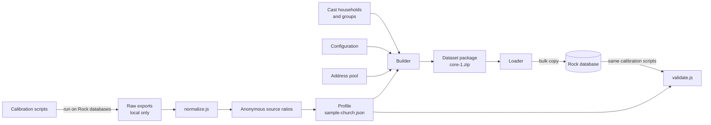

# How it works

This page follows the data from the files in this repository to a loaded Rock database.

## The pipeline

1. **Measure.** The calibration scripts run inside a Rock database and return only anonymous counts and ratios.
2. **Normalize.** `calibration/normalize.js` turns that output into a source file of ratios. Raw exports never leave the git-ignored `calibration/raw/` folder.
3. **Blend.** A profile (`calibration/profiles/sample-church.json`) blends one or more sources into target numbers, and records each exclusion and override with a reason. `resolve-profile.js` produces the final numbers.
4. **Pack.** The [builder](../builder/README.md) reads the Cast, the configuration, the address pool, the photos, and the resolved profile, and writes one package per dataset for one Rock major release, such as Rock 21 (decision 52). A package holds data only, never SQL, and no dates are fixed in it.
5. **Load.** The [loader](../loader/README.md) checks the package, that it is new enough for the package, and that the database's Rock is the package's major release, read from Rock's `Rock.Version.dll`. Then it generates the timeline for the install day, and writes the dataset into a fresh Rock database.
6. **Grade.** The loader CLI runs the same calibration scripts against the loaded database, and `validation/validate.js` compares the results with the profile.
7. **Verify.** Before a package is published, the [verify tool](../verify/README.md) loads it into a clean copy of the Rock release it is built on, the newest dot release of its major, and checks it against Rock itself, then writes a receipt. Publishing needs a passing receipt. See [Verification](verification.md) for every check and why it is there.

## The data files

| Files | What they say | Who edits them |
|---|---|---|
| `cast/households/*.json` | Each Cast family: people, ages, statuses, story, test purposes, attendance and giving patterns, address, photo inputs | People designing test cases |
| `cast/prayer-requests.json` | The Cast's own prayer requests and the state each shows in Rock | People designing test cases |
| `cast/groups/*.json` | Cast groups and their members. Small groups are plans that the builder writes with `--plan-cast-groups`; the serving team rosters are hand-picked. | People designing test cases; the builder for small groups |
| `configuration/*.json` | Campuses, service times, funds, check-in rooms, the area codes of generated phone numbers, connection statuses, kids achievements, every small group rule, prayer category weights, the serving teams and serving opportunities, the group types with Peer Network on and who follows whom, note types, the adult and student step programs, the building campaign, and the kinds of refunds and in-kind gifts | People shaping the church setup |
| `configuration/calendar.json` | The church's events on Rock's Public and Internal calendars: audiences, campuses, places, contacts, and the rule for each event's dates | People shaping the church setup |
| `configuration/registrations.json` | The church's event registrations: template categories, group types, templates with forms, fees, discounts, and placements, the rule that makes each instance from a calendar event, who registers for each and how they pay, the camp and mission trip releases, and the data views about registrations | People shaping the church setup |
| `configuration/communications.json` | The church's texting numbers, senders, topics, branded email template in both of Rock's formats, and communication lists with their membership rules | People shaping the church setup |
| `configuration/assessments.json` | Who takes Rock's five assessments, who asks them to, and when: staff, classes, leaders, and some active adults, with how many finish and what leaders' answers lean toward | People shaping the church setup |
| `configuration/reminders.json` | The Cast's hand-written reminders and the state each shows in Rock, the rules for the reminders staff and small group leaders set in the generated datasets, and the notes those reminders use | People designing test cases and shaping the church setup |
| `configuration/step-workflows.json` | The staff follow-up workflows that steps start: each workflow type, its trigger, who gets its task, its form, and what a completed task holds, and the Cast's follow-up stories | People designing test cases and shaping the church setup |
| `configuration/background-checks.json` | Rock's background check requirement on small group leaders, the leader mix, the Cast people with no check, the Cast's check stories, and the Checkr package and report searches | People shaping the church setup |
| `configuration/benevolence.json` | The benevolence types and their security, the case worker, the Cast's requests with their dates and amounts, the rate and mix of generated requests, their text, and the assistance agreement | People shaping the church setup |
| `cast/staff-emails.json` | The Cast staff's hand-written personal emails to Cast people | People designing test cases |
| `cast/sms-threads.json` | The Cast's hand-written text conversations and the state each shows in SMS Conversations | People designing test cases |
| `content/communications/*` | The message library (emails, newsletter pieces, texts, pushes, conversation pools, SMS snippets, email sections, and sermon series), the email template in both of Rock's formats, and its logo, checked by `check-library.js` | People writing sample text |
| `configuration/adaptive-messages.json` | The church's personalization segments, each on a data view, its five adaptive messages with their adaptations in order, their dates and saturation, the Finance lock on segments, and the Cast people each adaptation must reach | People shaping the church setup |
| `configuration/staff-homepage.json` | Rock's staff homepage: the weekly updates' author, post time, and link, the homepage metrics and their schedules, and the church's Quick Links | People shaping the church setup |
| `content/internal-news/*` | The staff updates' features and articles, each tied to an occasion or evergreen, checked by `check-news.js` | People writing sample text |
| `content/adaptive-messages/*` | Each adaptation's call to action, link, summary, details, and image, checked by `check-messages.js` | People writing sample text |
| `configuration/signals.json` | The church's person signal types and who may see and add each, the Cast's signals with their owners and notes, and how many Care Team Follow-ups each campus pastor has | People shaping the church setup |
| `configuration/personal-links.json` | The bookmarks in Rock's bookmark menu: shared sections secured by role, staff members' personal sections, each campus pastor's My Campus section, and the Rock page and load part behind each link | People shaping the church setup |
| `configuration/tags.json` | The church's tags on people: organizational tags in their tag categories, staff members' personal tags, Rock's own Staff tag, the Cast people each story tags, the rules that draw generated people, and the access questions verify asks Rock | People shaping the church setup |
| `content/prayer/*` | Text pools for prayer requests, answers, and prayer team comments, checked by `check-pools.js` | People writing sample text |
| `calibration/profiles/*.json` | Target numbers for everything generated | People adding calibration sources |
| `addresses/pool.json` | 18,000 placed addresses | Built by `addresses/build-pool.js` |
| `names/first-names.json`, `names/surnames.json` | The top 200 first names for each gender and birth decade, and the top 2,000 surnames, each with its count | Built by `names/build-names.js` from public-domain data |
| `names/nicknames.json` | Common nicknames for first names in the tables | People shaping the Crowd |
| `photos/manifest.json` | Every generated photo and the prompt that made it | The image agent |

## One load, step by step

The loader runs the steps below in one database transaction. A failure rolls everything back and shows the error that stopped the load, even when the rollback fails too. `--dry-run` rolls back on purpose. Every inserted row carries `ForeignKey = SampleData:<dataset>`, except in the few Rock tables that have no such column (see [Loading a package](../loader/README.md#loading-a-package)).

1. **Configuration.** Connection statuses, service time slots, campuses and their schedules, funds with a child account per campus, and check-in rooms, with Student Night on Wednesday beside the Sunday student service. Check-in is then set up on purpose: the Weekly Service Check-in template's supervisor mode, checkout at the kiosk and in the Check-in Manager, and duplicate check-in prevention, Rock's next-gen labels on each area, room limits with firm ones in the nursery, a second room for Grades 4-6 with Rock's Balance strategy, and Rock's Test Group in every kids and student room at every campus on both of Rock's all-day test schedules. After serving is set up, a Volunteer Test Area under Rock's Volunteer Check-in template gets a test group at each campus in every room a team serves in, on the same test schedules, so volunteer check-in can be tested too while real teams keep only their real services (decisions 367 to 371). The Built on the Rock campaign fund gets the campaign's dates, and Rock's two pledge pages and default contribution statement point at it (see [Pledges](pledges.md)). It also sets up small groups: the capacity rule, the Host role, the group attributes, the topics, the inactive reasons, and a parent group per campus. Then it sets up serving: eight teams at every campus with their rooms, service times, staffing, and background check requirement, and Rock's Involvement connection type with the eight serving opportunities. Small group leaders get Rock's Background Check Required requirement too, which they cannot override (decision 334). Last, the church's own categories from `configuration/categories.json`, such as the Rock Solid Church data view category and its children, with their security (decisions 185 and 223), and the four person signal types from `configuration/signals.json`, with who may see and add each (decision 279).
2. **People.** Cast families, people, family memberships (including children shared between two homes), addresses with map points, and phones. Households at one address share one Location, as Rock saves them. Every address, and every campus's map point, carries the marks Rock leaves after its address service checks an address, so Rock never sends a sample address to one (decision 315). For Full 7 and Core 3, generated households are added from the profile, and their small groups are planned before they load. Every campus also gets businesses: the Cast's 6 on the main campus, and at least 2 generated ones at each other campus. Each business has one or two contacts, loaded as Rock's Business Contact relationship. Every other Cast known relationship loads too, both halves, such as Craig Lowe, who may check in his daughter Madison, and the Morgans, whose grandchildren Mason and Chloe Kelly show at a kiosk search for the Morgans. About 3% of attending generated families with a child 12 or younger get one adult from another family who may check the children in (decisions 365, 366, and 372). Cast staff join the security roles their stories give them, all roles Rock ships (decision 79). Each of the 23 staff gets the Staff person attribute category's values, such as title, department, supervisor, bio, and staff photo, which the Extended Attributes block on the person profile shows (decision 201), and joins the org chart: Rock's Organization Unit groups, each with its leader and staff (decision 202). Each campus's pastor is its leader in Rock, which Rock's campus page shows as Leader, so a baptism's follow-up task goes to them (decision 291). Alisha Marble loads into Rock's own admin person (Person Id 1) instead of a new person, so the `admin` login signs in as her (decision 177). A Cast person's allergy goes into Rock's Allergy person attribute, which check-in labels print (Alex Decker's peanut allergy). The loader fills in what Rock's save hooks would set: ages, grades, giving Ids, giving leaders, primary family, and campus.
3. **Photos.** Every Cast person gets their delivered profile photo, except the few left without one on purpose. Each serving opportunity gets its photo, and each campus its exterior photo, as the image of its Location (decision 317). In Core 3, about half of the generated households get faces from a shared pool, one photo ethnicity per family. Full 7's crowd gets none.
4. **Attendance.** For each Sunday in the history window (3 years by default), each household attends at its own rate, adjusted for holidays and the month. Adults are recorded at worship. Children check in to the room their age or grade puts them in on that date, with a security code per family per Sunday. A student who comes on their own gets their own code. Students in grades 7 to 12 also come on their own: an engaged student comes on some Sundays the family stayed home, and some keep coming for a while after the family stops. Generated adults aged 18 to 20 check in as students until they graduate. Students are planned after every family, from their own seed, so adults and young kids are not affected (decisions 146 to 148). Students also check in on Wednesday nights at Student Night: each Cast student with a Student Night habit, and generated regulars, mostly in weeks they also come on Sunday (decisions 363 and 364). Every check-in names a kiosk at its own campus, from `configuration/kiosks.json`: a family's usual kids kiosk, the student kiosk for a student on their own, and the volunteer kiosk for a volunteer. Each security code opens one check-in session at its kiosk, with the last four digits of a phone as the search (decisions 360 and 361). After their service, kids from the nursery through 6th grade are checked out by the adult who checked them in (decision 362). Last come the adults from other families: Karen Morgan brings her Kelly grandchildren on some Sundays their mother works, and a generated child's check-in adult checks them in on about a third of their family's Sundays, in that service. Grades 4-6 check-ins then alternate between its two rooms in arrival order. No attendance uses Rock's test schedules. Every attendance row, here and in small groups and serving, gets the check-in status Rock's save hook would give it: Checked Out for a kid's check-out, Present for any other check-in, and Not Present for a row with no present time (decision 260).
5. **Achievements.** The Kids Check-in streak type and its seven achievement types, from High Five to Century Club. Each child who checked in gets a streak, counting each week they checked in, Student Night included, and the achievement attempts Rock would have made at each of their check-ins. Next-gen check-in lists the seven types, so kiosks show each child's progress.
6. **Small groups.** The Cast's planned groups from `cast/groups` and the generated groups for each campus. About one in six of a campus's groups study the Women's Bible Study with a woman leader and only women, and one in ten the Men's Bible Study. No household is in a group before four weeks after it started coming, or after six weeks past its last Sunday. A third of the groups started on a recent launch Sunday, and two thirds of those are led by someone who was Ready to Lead six weeks before (see [Small groups](small-groups.md)). Each group gets its schedule, its meeting place at the host's home (or a meeting link), its members, its attribute values, and its history. Weekly attendance follows the church year in [Small groups](small-groups.md): fall and spring seasons, a light summer, and holiday weeks marked "did not meet". Each Cast group gets a photo of its leader and spouse, and Group Finder shows it on the group's card.
7. **Serving.** The Cast's rosters and generated volunteers at every campus, each with a rotation and preferences. Every Sunday in the history window, volunteers on their rotation serve when their family came and check in to serve; the next six weeks are scheduled ahead. A small group leader who launched from Ready to Lead was serving half a year before then, and never leads a team. See [Serving](serving.md).
8. **Connection requests.** A connected request behind every recent volunteer, people who just connected and wait as Pending, and active and inactive requests in the measured mix, each with its activity history. Team leaders connect them, except the main campus's new requests, which Alisha Marble connects (decision 178). Connectors record celebrations on some of the requests they have worked, the Cast's hand-written (decision 219). Due dates run by status, so each active request is due later, due this week, or past due by the mix in `configuration/connections.json` (decision 173).
9. **Background checks.** They follow the connection requests, as their own part (decision 333). From `configuration/background-checks.json`, each person gets one latest check, written the way Rock's Checkr provider writes it, with its report drawn as a PDF: a Cast story first, then every adult on the Kids Ministry and Student Ministry teams (a pass from the last few years), then small group leaders (85% current, 6% expiring, 5% expired, and 4% never checked), then anyone whose request to serve waits in the Background Check status (still in progress). Each finished check sets the person's Background Checked, date, and result, and every team member and leader gets the requirement result Rock's Calculate Group Requirements job would have saved. Ted Decker's check is too old, Bill Marble's runs out in about five weeks, Jerry Wright has none, and Frank Dexter's failed.
10. **Giving.** Each giving pattern produces gifts on its rhythm (weekly, bi-weekly, monthly, quarterly, irregular, occasional, year-end, or one-time). Gifts come through a channel: scheduled, online, in the offering, or a mailed check. They land in batches by day, campus, and channel, and checks always get batches of their own, because churches run them through a check scanner. Most couples give together as one giving unit, and about 10% give separately. Who pays how follows age and gift size, so older givers write most checks. Before the gifts are planned, the Built on the Rock pledges are planned: a pledger's usual gifts carry a campaign line sized to their pledge and how it is going, and some give extra campaign gifts. The pledges are written after the gifts, and both load only with the giving part. The fund's goal comes from the planned pledges and is written in every load (see [Pledges](pledges.md) and decision 126). Last come the refunds, at the calibrated rate of about 2.5 for every 1,000 gifts: duplicate online gifts, amounts typed with an extra zero, one fund of a two-fund gift, gifts from an earlier year, and checks the bank returned. Each is written the way Rock's refund saves it, in a " - Refund" batch. The Cast has two, Gabriel Hernandez's duplicate gift and Javelina Wash Coffee's returned check (see [Refunds](refunds.md)). A few gifts are uncommon: stock, vehicles, and equipment given in kind, with Rock's asset type and a description for the statement (see [Uncommon gifts](uncommon-gifts.md)).
11. **Giving analytics.** The loader fills in what Rock's Giving Automation job would have written if it had run every night: each giver's giving attributes, giving bin and percentile, and journey stage with a year of history. Rock's own stored procedures do part of this work. Each replayed run reads the gifts as they stood that night, so a gift refunded later still counts on the nights before its refund (decision 263).
12. **Giving alerts.** The sample church's three alert types (Large Gift, Smaller Than Usual, Late Gift) come with the 12 months of alerts Rock would have raised, as each night's run saw the gifts.
13. **Family analytics.** eRA, as if Rock's Family Analytics job had run every Tuesday at 8 PM since the start of the history window. A family enters when an adult gave four times in a year with one gift in the last six weeks, or the family came on eight of sixteen Sundays, and it exits after eight weeks with no gift, four with no Sunday, and fewer than eight Sundays in sixteen. Each member gets Currently an eRA, an eRA Start Date and End Date, eRA steps in Rock's Core Steps program, and eRA history lines. One more run at the start of install day takes in the newest Sunday, so the job's first run changes nothing. Then Rock's own giving and attendance count procedures fill Times Given, First and Last Checked-In, Times Checked-In, and First and Last Gave, and the job is turned on with Set Visit Dates off (decisions 323 to 326). It reads the rows the earlier steps wrote, so it always runs. See [eRA](steps.md#era).
14. **Prayer.** About 10 requests a week come in for every 1,000 adults who attended, gave, or were in a small group in the last year. Those adults ask most, and others on the church's records ask now and then, mostly once and a few several times, through the profile's months, weekdays, and hours. Each request gets a Rock prayer category by its weight in `configuration/prayer.json` and text built from that category's pool in `content/prayer`. A prayer administrator from the Cast approves most within hours, which sets them to expire 14 days later, and the newest few still wait for approval. The prayer team (the Cast's Prayer Team plus about 3% of active adults) prays through each approved request while it is active, each prayer a "Prayed" interaction, as Rock's prayer session records it. A few requests are flagged back to the approval queue, some get comments and a reply, and some older ones get an answer (decision 67).
15. **Notes.** The six note types on person records get their settings and View security (see [Configuration](../configuration/README.md#notes)). The Cast's hand-written notes from `cast/notes` load on every dataset. Generated people get notes built from the text pools in `content/notes`: who gets notes and how many follow the designed targets in the profile, and the day and time follow the measured shape. Some notes get replies from other staff, a few are alerts, private, or pinned, and some mention another staff member. Each mention in a note from the last 89 days leaves the mentioned staff member the notification message Rock makes. Their bell counts it and opens the note. A message from the last three days is unread, and every older one is read (decision 307). A load without Rock's DataEncryptionKey writes mentions as plain names and no messages.
16. **Reminders.** Reminders staff and leaders set for themselves, from `configuration/reminders.json`, in Rock's two shipped reminder types: a Personal Reminder about a person and a Group Reminder about a group. The Cast has three. Ted Decker's monthly check-in with Ashley Kelly, before her rent comes due, is due now. His reminder to ask Josh Sanders to share his story at the next baptism Sunday is upcoming. Bill Marble's reminder to plan the Marble Group's end-of-season party is upcoming too. On Core 3 and Full 7, staff also set reminders about some of the generated people they wrote notes on in the last year, and the leaders of some active generated small groups set one about their group. Each is dated from the install day, so some are complete, some are due, some are upcoming, and a few repeat. Last, each owner's reminder count, which Rock's bell shows, is set the way Rock's Process Reminders job sets it. See [How reminders load](../loader/README.md#how-reminders-load).
17. **Benevolence.** It follows the reminders, as its own part (decision 350). Rock's default type and three church types from `configuration/benevolence.json`, each locked to RSR - Benevolence and RSR - Rock Administration. Requests are saved the way Rock's request block saves them, with Dee Navarro as case worker: the Cast's four, such as Ashley Kelly's rent and the Wards' electric bill, and about 2 a year for every 1,000 generated adults, mostly approved, with results and amounts. Approved rent, utility, car, and medical requests have a signed assistance agreement drawn as a PDF. Each church type starts a workflow when a request is entered, which gives a request with no case worker to Dee and sends no email (decision 355).
18. **Steps.** Rock's Discipleship Path is built out to seven steps from `configuration/steps.json`, and every step comes from a record the earlier steps wrote (decision 86). Small Group, Serve, and Lead steps follow each small group and serving team membership, read back from the database. Give steps follow the giving journey, replayed every Tuesday night over the history window. Baptism steps follow the Baptism Date, which generated adults get here, with Baptized Here on the step and the person. Starting Point Class and Foundations fall on real class dates that count back from the install day: every volunteer took Starting Point before serving, a small group leader who launched from Ready to Lead and was not baptized by then took Foundations before that day, a few people per campus are in each current class, and the rest follow designed shares of active adults. The Student Path is a second program from the same file. Its steps follow the student check-ins the attendance step planned, and they are planned once in every load, right after attendance, so registrations read the same plan (decision 206): Student Camp and Mission Trip on church-wide event dates, Follow Jesus at camp or on a Sunday the student came, and Student Leader from August of junior or senior year to graduation, each for a designed share of the students who could. Many students who decide to follow Jesus are baptized on a later baptism Sunday, often the July one after camp, on the same Baptism step. People whose Complete steps cover every step type in a program get a completion for it, the way Rock's Update Step Program Completions job records it. Right after the steps, the staff follow-up workflows from `configuration/step-workflows.json` load, as part of the steps (decisions 290 to 292). Baptism Follow-Up starts when a Baptism step is completed, and goes to the campus pastor of the step's campus. Follow Jesus Follow-Up starts when a Follow Jesus step is completed, and goes to Isaac Silva, the Student Pastor. Volunteer Care Check-In is on the Serve step, and staff start it by hand. Each is a task with a form and no email. The workflow types were built 12 months before the install day, and every Baptism and Follow Jesus step completed since has the workflow Rock would have launched. A task whose step was completed in the last 14 days waits in its assignee's My Workflows list, and the assignee completed each older one. Josh Sanders's baptism task is complete, and Dennis Perry's is open (decision 293). See [Steps](steps.md).
19. **Assessments.** They follow the steps, as their own part. Rock's five assessments, DISC, Spiritual Gifts, Conflict Profile, Emotional Intelligence, and Motivators, are requested and taken by the rules in `configuration/assessments.json`: staff take all five when they start, Starting Point asks its class for Spiritual Gifts and Foundations for DISC and Motivators on the first night, every current leader takes DISC and Conflict Profile before leading, and some active adults take one on their own. Each person's answers lean toward a target and are scored with a port of Rock's own scoring, so the answers saved on each assessment and the results saved as person attributes always agree. Some requests stay pending, and each one's last reminder is where Rock's reminder job would have left it. The Cast's stories, including six DISC results taken outside Rock's own DISC, come from their household files. See [Assessments](assessments.md).
20. **Peer network.** Rock's Peer Network is on for small groups and serving teams. Campus pastors follow their campus's small group leaders, and staff follow up to 25 people in their care. Then each pair of people who shared a group, and each follow, gets the score Rock's Calculate Peer Network job's last two monthly runs would leave, with Rock's trend arrow: rising while two people stay, falling after one leaves, and flat for a follow (decisions 328 to 330). It reads the groups and notes the earlier steps wrote, so it always runs. See [Peer network](small-groups.md#peer-network).
21. **Data views.** The church's layered data views from `configuration/reporting.json`: foundations, the Ministry by Design stage views built from steps, next-step views filed by Ministry System, the communication flows' audiences with their email guard, the Safety views, the Finance views, and two Staff Workspace views built on tags, each stamped with the staff member who made it (decision 306). They load before communications, because the New Here and We Miss You group syncs are built on the foundations. A view that points at a registration view waits for step 23. Rock's own Foundational Views category is renamed Foundational Views (Shipped). A view that needs a part the load left out is skipped.
22. **Calendar.** The church's 51 events on Rock's Public and Internal calendars, with their audiences and photos. Each event gets an occurrence for each campus and start time, from the start of the history window to 13 months ahead, with its own schedule, place, and contact. Dates follow the rules steps and messages use, so Easter, the baptism Sundays, the classes, camp, and VBS fall on the same days everywhere. Rock's four sample events become church events in place. See [Calendar](calendar.md).
23. **Registrations.** Event registration setup for camp, the mission trip, the fall retreat, VBS, Parents' Night Out, Serve Day, Money Matters, Date Night, and the Women's Retreat: template categories, templates with forms, fees, discounts, and placements, and each year's instances linked to their calendar occurrence with a public name and URL slug, their linked group, and their placement groups. Seven registrations are open on every install day. Then the students who registered for camp, the mission trip, and the fall retreat, from the Student Path plan: last summer's campers are exactly the students with that camp's step, and the open ones fill in by how far into their window the install day is. Each registration has its registrar, fees, answers, and discount, payments in daily batches with payment plans and reminders, its people in the linked group, and campers on buses, in cabins, and in activities. Kids and adults register too, from the people and the small group and serving plans: families for VBS and Parents' Night Out, volunteers and their teens for Serve Day, couples for Date Night, and adults, couples, and friends from one small group for Money Matters and the Women's Retreat, with crews by grade, project teams, childcare per child, rooms, and the Allergy question saved to the child. Every camper and mission trip student has a release their registrar signed while registering, typed, with Rock's verification hash and a PDF drawn at install. Every registration has the notes and history Rock writes as it saves, instances whose reminder day has passed are marked sent when Rock's job would have sent them, and three data views about registrations sit under the church's Registrations category, one of them the mission trip's eligibility rule. See [Event registrations](registrations.md).
24. **Person attributes.** Rock's own person attributes, listed in `configuration/person-attributes.json`, which the Extended Attributes tab, check-in, and data views read. The Cast's values come only from their files: Employer, Position, Legal Notes, and Do Not Send Giving Statement. Generated people get drawn values, each from its own seeded stream, so no other row changes. About 10% of working-age adults have an employer, and every business contact works at their own business. Kids and students in half the households have a school, from invented schools near each campus. The kids of two single-parent households per campus have a pickup or custody note. Households that first came inside the history window have a Source of Visit and sometimes a Previous Church. A kid who never answered Allergy on a registration form gets the same draw the form uses. Everyone gets the values their records give. Some young kids, Cast or generated, have the ability level of the nursery or preschool room they check in to. Date Engaged, a person attribute the loader adds to Rock's Membership category, holds the day each Engaged or Leading adult first joined a small group or serving team or first gave, and a share of check writers have an Envelope Number. See [How person attributes load](../loader/README.md#how-person-attributes-load).
25. **Communications.** The church's texting numbers: a main line, a student line, and staff personal numbers, with one for each campus pastor. The branded "Rock Solid Church" email template with the approved logo, in Rock's email wizard, and its Legacy version for Rock's older editor (decision 269). Four email sections for Rock's newer email editor, styled like that template, in a Rock Solid Church category: Service Times, Upcoming Event, Give Online, and Built on the Rock Update (decision 301). A weekly newsletter list per campus, seven ministry and staff lists, and two care lists, New Here and We Miss You. Who is on each follows involvement: involved adults get their campus newsletter, Leading and Engaged adults opt in to more lists, and the Volunteers, Small Group Leaders, and Prayer Team lists copy the teams, the leaders, and the prayer team. Nobody who chose "No mass emails" or "Do not email" is on a list. Then two years of bulk email: each campus's weekly newsletter, church-wide emails to each campus's involved adults, and ministry emails, each recipient sent or refused the way Rock's send path decides, with opens, clicks, bounces, unsubscribes, and the History lines Rock writes. Then the church's SMS snippets, shared ones in five categories and personal ones for Isaac Silva, Ted Decker, Alisha Marble, and each campus pastor, and two years of texts: mass texts on the main and student lines with their replies and STOPs, the Cast's hand-written threads, and generated conversations, mostly on staff members' personal numbers, where about a quarter of the staff's first replies about a snippet's topic are its text. Then two years of one-to-one email: serving confirmations and reminders, connector follow-ups, prayer celebrations, first-visit welcomes, and the Cast staff's personal emails. Then the church's app, its devices, and two years of pushes with their opens. Then the messages tied to steps: class emails and texts, baptism follow-ups, and the finished After Starting Point flow. Last, five group syncs: data views that keep the Volunteers, Small Group Leaders, New Here, and We Miss You lists and the RSR - Prayer Access role in step, each group filled as Rock's Group Sync job would leave it on install day, so the job's first run changes nobody and sends nothing. See [Communications](communications.md) and [Group sync](communications.md#group-sync).
26. **Reports.** The 26 reports on the data views, with Leadership, Safety, and Finance locked to their own roles, and the one data view that waited for the registration views. Then each view and report gets a run history: when staff made it, how many times it has run since, and when it last ran. One view, Men's Retreat Invites, has not run in over a year. Last, the four Ministry Path metrics: a Rock Metric for each stage that counts its stage view every Monday, with a value for each week since the view was made, read back from the steps. See [Data views and reports](reporting.md).
27. **Adaptive messages.** The 22 personalization segments from `configuration/adaptive-messages.json`, each on a church data view, refreshed daily as Rock's segment editor sets one, with the people Rock's Update Personalization Data job would put in each on install day. A segment built on a Finance view is locked like Finance, and so is Rock's segment Results page. Then five adaptive messages in a Rock Solid Church category, each with its adaptations in order, their segments, dates, and text from `content/adaptive-messages`, some with a copy of an approved event image or of an image from the message image brief. A segment whose view this load left out is skipped, with every adaptation that names it. Last, an HTML Content block on the External Website homepage shows each signed-in person their cards through Rock's adaptivemessage Lava command. See [Adaptive messages](adaptive-messages.md).
28. **Content.** Rock's staff homepage gets a staff update every Monday for the last 52 weeks, posted by Daniel Peak, the Director of Communications, at 8 AM. Each has a feature and one to three staff articles from `content/internal-news`, following the church calendar: Easter planning, VBS volunteers, Commitment Sunday, year-end statements, and more, with evergreen pieces between. Feature images are approved event images and article images are their authors' staff photos, each stored once and shared. Rock's own 2018 item becomes the oldest update. See [Staff homepage](staff-homepage.md).
29. **Staff homepage.** A year of values for Rock's three homepage metrics, Active Records, Active Families, and Active Connection Requests, on Rock's own schedules, as Rock's Calculate Metrics job would have saved them. The four Ministry Path metrics join them on the homepage, and Rock's Quick Links get four church links.
30. **Signals.** The Cast's six signals from `configuration/signals.json`, such as Frank Dexter's Safety Team Review and Maddie Lowe's Pickup Instructions, each with its owner and note, and six Care Team Follow-ups on each campus with generated households, owned by its campus pastor, most of them ended. Each person gets the top signal Rock's own rule gives them, which the Top Person Signal badge on the profile shows, and an ended signal shows none. The Safety Team Review data view in the Safety category lists the people with that signal. See [How signals load](../loader/README.md#how-signals-load).
31. **Personal links.** The bookmarks behind the icon beside Rock's search bar, from `configuration/personal-links.json`: four shared sections secured by role (Sunday Morning, Care, Finance, and Communications), a private section for six named staff and for each loaded campus pastor, and each owner's section order. Every link opens a Rock page with sample data on it. A link to a part this load left out is skipped. See [How personal links load](../loader/README.md#how-personal-links-load).
32. **Tags.** The church's tags on people from `configuration/tags.json`, saved as Rock's tag bar saves them (decision 302). Organizational tags sit in a tag category from `configuration/categories.json`, whose security decides who can see and use them: Homebound in Care, and Car Show Volunteers in Events (decision 303). Personal tags belong to the staff member who keeps them, such as Jamal Pierce's Possible Group Leaders and each campus pastor's Coffee This Month (decision 305). Rock's own Staff tag, found by its Guid, holds every staff member the dataset loads. A Cast person carries a tag only when their story gives it. Generated people are drawn by each tag's rules, such as Homebound's 20% of generated adults 80 and older who live alone (decision 304). A draw never picks a Cast person. Each person is tagged after the tag was made and after their family first came. A tag whose owner or maker this dataset does not load is skipped. Tags load in every dataset, after the data views, because Possible Group Leaders draws from Ready to Lead. See [Tags](../loader/README.md#tags).
33. **Logins** (when the person installing gives a password). The Cast's logins from their files, campus pastors' included, and a designed share of generated adults from `configuration/logins.json`, all with the one password, hashed the way Rock's Database login stores it. Each login has the person history Rock writes. Every load also sets each person's account protection profile the way Rock does. See [How logins load](../loader/README.md#how-logins-load).
    After the last part, the loader runs Rock's attribute value save hook once over every attribute value it wrote: the date, number, yes-no, and person columns Rock derives from each value, which attribute filters in data views read (decision 249).
34. **Duplicates.** First, the merges already made: Sarah Simmons's old Sarah Jones record, merged into hers, leaves its alias on her, a Merged line in her History, and Jones as her previous last name, the way Rock's merge leaves them. Then Rock's own duplicate finder procedure runs, as Rock's Calculate Person Duplicates job does every night at 3 AM, so the Duplicate Finder is full on install day and the job's first night finds nothing new. Then the Cast's decisions: Tom and Thomas Miller and Jon Smith's two duplicates stay open, the other John Smith is Not a Duplicate, and Jon's two John Smith records are ignored from each other. Last, Jamal Pierce's merge request for Jon's three records. See [Duplicates](duplicates.md).
35. **Cast and business expectations** (the CLI and verify only; Rock's block skips them, decision 217). The loader checks that key Cast people show what their stories say, for example that the Deckers are monthly, consistent givers, that Sam Lee has earned Century Club, that Ted Decker has completed the Discipleship Path, and that Jasmine Washington has completed the Student Path, that each staff texting number belongs to its staff member, that Kevin Dawson left the Men list and Brandon Watson chose "No mass emails", that each Cast text thread shows in its intended state, that each Cast staff email shows in the person's Communication History, that Rock's email wizard lists the church's branded template, that each Cast reminder is on its owner and about its person or group, and shows due, upcoming, or complete as its story says on the install day, that each Cast owner's reminder count, which Rock's bell shows, is what Rock's Process Reminders job would set, that each step workflow type has its trigger, that every Baptism and Follow Jesus step completed since the trigger was built has one workflow, open or complete as its date says, assigned to the right person, with each open one in that person's My Workflows list, that Josh Sanders's baptism task is complete with the answers and note his story gives, and that Dennis Perry's is open, that each Cast person shows the person attribute values their file holds, such as an employer or a legal note, that each Cast family's small group memberships fit when it came, so the Ortizes left their group after they stopped coming and the Ellises have only a request to join, that each Cast small group pin holds, such as the Sweeneys together in one group, and that each Cast duplicate pair, merge request, and merge in `cast/duplicates.json` shows in Rock. It also checks that each campus has its minimum number of businesses, that every business has a contact and a gift in the last 12 months, and that each Cast person in `configuration/adaptive-messages.json` sees their adaptation, such as Ted Decker's thanks for his scheduled gift. Each Cast person with a signal has it, with its owner, and the flag their story gives them, or none for Derek Ward, whose signal has ended. The Deckers, the Ellises, the Ortizes, and Bri Hall show their eRA stories, Ted Decker's peer network shows Cindy and everyone in his current groups, rising, and every Cast person who left a group sees its people falling. It checks each Cast background check story, such as Ted Decker's leader requirement showing Not Met and Frank Dexter's failed check linked to his request to serve, and each Cast benevolence request's case worker, status, and amounts, such as Ashley Kelly's $1,425 for rent. Each Cast known relationship shows on both people, a kiosk search for the Lowes shows Madison and one for the Morgans shows Mason and Chloe Kelly, and Karen Morgan has checked in her grandchildren on some Sundays.
36. **Check images** (optional, `--check-images`). Each recent check gift gets a scanned front and back that match the gift.

## Dates and repeatability

- Every date in a data file is relative: `yearsAgo` plus a month and day, or `daysAgo` for recent events.
- The **anchor** is the date everything counts back from. It defaults to today on the database server, the clock Rock Cleanup uses for ages (decision 152). Pass `--anchor yyyy-MM-dd` to pin it.
- Every random choice comes from a stream seeded by the `--seed` text and the household. The same seed and anchor give the same data, row for row.
- After install, Rock's own jobs move the data forward from the anchor, the way they do for any church. [After you install](after-install.md) says which jobs the load already covers, which to run, and which to watch.

## The tools

| Command | What it does |
|---|---|
| `node cast/validate-cast.js` | Checks every Cast file: required fields, Guids, cross-references, statuses, and photo rules. |
| `node cast/build-pages.js` | Rebuilds the family pages in `cast/families/` from the household files. |
| `node addresses/build-pool.js` | Rebuilds the address pool. Add `--cast` to give Cast households addresses. |
| `node calibration/normalize.js` | Turns calibration output into a source file, or into a scratch file with `--out`. |
| `node calibration/resolve-profile.js` | Resolves a profile into final target numbers. |
| `dotnet run -- --rock <Rock checkout>` (in `builder/`) | Writes one package per dataset to `packages/`. See [Builder](../builder/README.md). |
| `dotnet run -- --package <file.zip> --connection "..."` (in `loader-cli/`) | Loads a package. It also runs calibration (`--calibrate`), the Cast expectations check (`--check-cast`), and the giving parity test (`--giving-parity`). See [Loader](../loader/README.md). |
| `dotnet run -- --plan-cast-groups` (in `builder/`) | Plans the Cast's small groups into `cast/groups`. Rerun it after a Cast or small group rule change, then rerun `build-pages.js`. |
| `dotnet run -- --deliver-photos <batch.json>` (in `builder/`) | Keeps new generated photos' originals, saves their 400-pixel copies, and adds them to the photo manifest. See the [photo brief](../photos/brief.md). |
| `node validation/validate.js` | Grades generated data against the profile. |
| `node validation/check-rock-lock.js` | Checks Rock on GitHub for changes to the code the loader ports. See [Validation](../validation/README.md#rock-version-guard). |
| `validation/achievement-parity/` | The achievements parity test. It runs Rock's own streak and achievement code on a loaded copy and compares the results with the loader's rows. See [Validation](../validation/README.md#the-achievements-parity-test-before-each-release). |
| `node validation/check-standards.js` | Checks the content standards that span folders: phones, emails, raw data, and calibration source labels. |
| `dotnet run -- --rock <Rock checkout>` (in `verify/`) | Proves each package works on its Rock and writes a receipt. Add `--check-receipts` for the publishing gate. See [Verification](verification.md). |

## Where the loader goes

The loader CLI installs packages for developers and test harnesses. A block inside Rock calls the same loader library through the `SparkDevNetwork.Rock.SampleData.Loader` NuGet package, which builds for the .NET Framework Rock runs on. A person picks the parts to load, and the loader refuses a database that already has people (decisions 120 to 122). Later, configuration will save through Rock's own services. Rock will never depend on this repository; everything it needs arrives in the package.
